<div align="center">

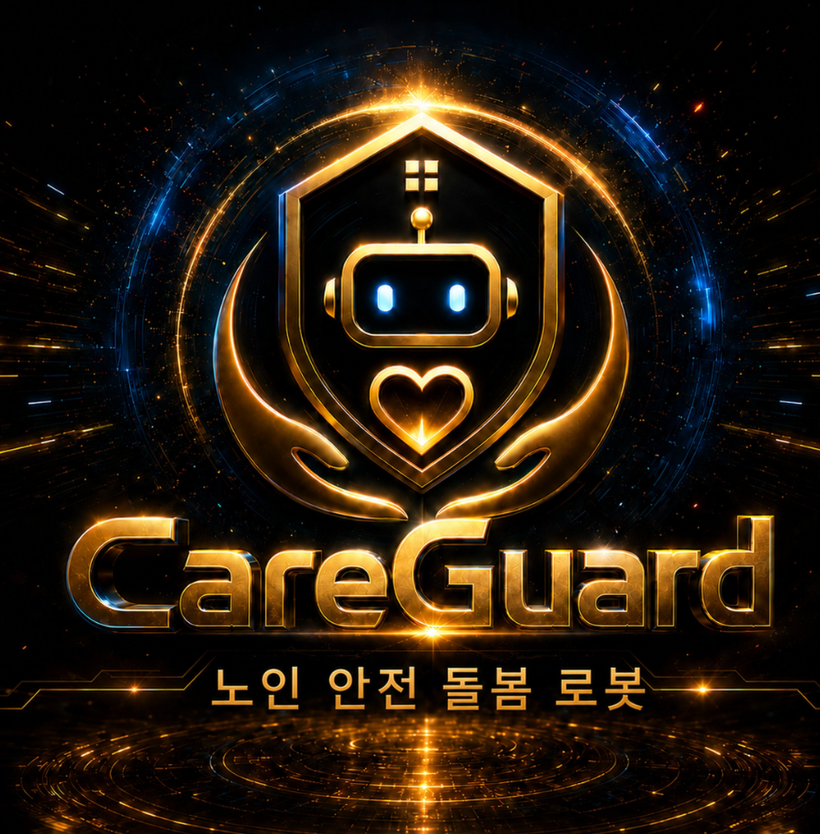

# DYNC CareGuard · 독거노인 순찰 · 복약 · 응급 대응 로봇

</div>

**프로젝트 기간 · 2026년 9월 6일 ~ 2026년 9월 18일**

> **로봇이 집 안을 돌며 대상자를 확인하고, 약을 건네고, 위급 상황을 바로 알립니다.**

실내 자율주행 로봇(LIMO / TurtleBot3)이 독거노인 가정을 정기 순찰하며 **복약을 관리**하고, 낙상 · SOS · 미등록 침입자 같은 **이상 상황을 감지**해 원격 관제 대시보드와 보호자에게 즉시 알리는 돌봄 로봇 프로젝트입니다. 중앙 서버 1대가 서로 다른 공유기에 있는 여러 로봇과 관제 화면, 보호자 알림을 하나로 연결합니다.

관제사는 Qt 대시보드(P1~P8)에서 로봇 · 대상자 상태와 이벤트를 확인하고 스피커 통화로 대응하며, 보호자는 자기 대상자만 읽기 전용으로 확인하고 이메일 알림을 받습니다.

<table>
<thead>
<tr><th align="center">LIMO (R-07) 순찰</th><th align="center">TurtleBot3 (R-05 / R-06) 순찰</th></tr>
</thead>
<tbody><tr><td align="center"></td><td align="center"></td></tr></tbody>
<tbody><tr><td align="center"><a href="https://youtu.be/W13FbSS3s6g">▶ 시연 영상 1</a></td><td align="center"><a href="https://youtu.be/5YQFwCbIxe0">▶ 시연 영상 2</a></td></tr></tbody>
</table>

---

<details>
<summary><strong>프로젝트 목차</strong></summary>

- [1. 프로젝트 개요](#1-프로젝트-개요)
- [2. 팀 구성 및 역할](#2-팀-구성-및-역할)
- [3. 운영 시나리오](#3-운영-시나리오)
- [4. 기능 요구사항](#4-기능-요구사항)
- [5. 시스템 아키텍처](#5-시스템-아키텍처)
- [6. 로봇 구성](#6-로봇-구성)
- [7. 약통 구조](#7-약통-구조)
- [8. 시퀀스 다이어그램](#8-시퀀스-다이어그램)
- [9. 핵심 기술과 문제 해결](#9-핵심-기술과-문제-해결)
- [10. 중앙 서버와 ROS 2 통신](#10-중앙-서버와-ros-2-통신)
- [11. 관제 대시보드](#11-관제-대시보드)
- [12. 현재 한계와 확장 목표](#12-현재-한계와-확장-목표)
- [13. 소스 구성](#13-소스-구성)
- [14. 프로젝트 기술 스택](#14-프로젝트-기술-스택)
- [15. 설치와 실행](#15-설치와-실행)
- [16. 문서](#16-문서)

</details>

## 1. 프로젝트 개요

### 기획 배경 · 주제 선정 이유

혼자 사는 노인은 해마다 늘고 있습니다. 통계청 「2024 고령자 통계」를 보면, 65세 이상 고령자 가구 565만 5천 가구 가운데 213만 8천 가구(37.8%)가 혼자 사는 가구였습니다. 가족이나 돌봄 인력이 매일 찾아가기 어려운 상황에서, 약은 제때 먹었는지, 집 안에 별일은 없는지 확인할 수단이 필요해졌습니다.

지자체들도 기술로 이 공백을 채우려 하고 있습니다. AI 돌봄 인형 '효돌'은 약 180개 지자체를 거쳐 1만 3천여 명에게 보급되어, 말벗과 복약 알림 역할을 맡고 있습니다. 하지만 한자리에 놓인 기기는 알림을 줄 수는 있어도 대상자에게 직접 다가가 약을 건네거나, 집 안을 둘러보며 상태를 살필 수는 없습니다.

그래서 **집 안을 직접 움직이며 대상자를 찾아가고, 그 결과를 관제사와 보호자에게 곧바로 전하는 이동형 돌봄 로봇**을 만들기 위해 이 프로젝트를 진행했습니다.

### 문제 정의

- **매일 찾아가기 어렵다** : 가족이나 돌봄 인력이 날마다 방문해 상태를 확인하기는 현실적으로 쉽지 않습니다.
- **알림만으로는 복약을 알 수 없다** : 알람이 울려도 실제로 약을 꺼내 먹었는지는 확인되지 않습니다.
- **낯선 사람을 알아챌 눈이 없다** : 혼자 지내는 집에 누가 드나드는지 지켜볼 사람이 없습니다.
- **도움 요청이 늦게 닿는다** : 위급한 순간에 직접 전화를 걸기 어렵다면, 도움이 필요한 때를 놓치기 쉽습니다.
- **로봇마다 따로 관리하기 번거롭다** : 여러 가정에 종류가 다른 로봇을 두면, 이를 한 화면에서 함께 볼 방법이 필요합니다.

### 개발 목표

목표는 사람이 매일 찾아가지 않아도 로봇이 대상자를 살피고 약을 건네며, 이상이 생기면 관제사와 보호자가 곧바로 알 수 있는 돌봄 서비스를 만드는 것입니다.

- **정기 순찰** : 요일 · 시각 스케줄로 순찰하고, 얼굴을 확인한 뒤 충전소로 돌아갑니다.
- **복약 관리** : 복약 시각에 이동해 안내하고, 약통을 열고, IR 센서로 수령을 확인합니다.
- **응급 대응** : 화면 버튼 · 호출 버튼 · 음성으로 SOS를 받고 관제사와 통화를 연결합니다.
- **침입자 감지** : 멈춰서 다가간 뒤 다시 판별해 오탐을 줄입니다.
- **통합 관제** : Qt 대시보드(P1~P8)와 로봇 후면 키오스크로 상태를 보여 줍니다.
- **보호자 알림** : 이벤트가 생기면 이메일을 보내고, 보호자는 읽기 전용 화면을 씁니다.

### 운영 환경

<table>
<thead>
<tr><th align="left">항목</th><th align="left">내용</th></tr>
</thead>
<tbody><tr><td align="left">대상</td><td align="left">상시 대면 케어가 어려운 독거노인 가정</td></tr></tbody>
<tbody><tr><td align="left">로봇</td><td align="left">LIMO (R-07), TurtleBot3 Burger (R-05 · R-06)</td></tr></tbody>
<tbody><tr><td align="left">운용</td><td align="left">중앙 서버 1대가 여러 로봇과 관제 화면 · 보호자 알림을 연결</td></tr></tbody>
<tbody><tr><td align="left">네트워크</td><td align="left">같은 공유기의 로봇은 Wi-Fi LAN, 다른 공유기의 로봇은 Tailscale VPN으로 서버에 연결</td></tr></tbody>
</table>

<sub>출처: [통계청 「2024 고령자 통계」 보도](https://www.ytn.co.kr/_ln/0102_202409261817206289) · [효돌 보급 현황 보도 (2025)](https://v.daum.net/v/20251010140138228)</sub>

## 2. 팀 구성 및 역할

<table>
<thead>
<tr><th align="center">담⁠당⁠자</th><th align="center">담당 파트</th><th align="left">주요 기여</th></tr>
</thead>
<tbody><tr><td align="center">최⁠치⁠언</td><td align="center">로⁠봇 연⁠동 ·<br>통⁠합 관⁠제 ·<br>로⁠봇 상⁠세 ·<br>설⁠정 · 통⁠합 로⁠그</td><td align="left">• T⁠u⁠r⁠t⁠l⁠e⁠B⁠o⁠t · L⁠I⁠M⁠O 로⁠봇⁠을 중⁠앙 서⁠버⁠에 연⁠결⁠, 다⁠른 인⁠터⁠넷⁠망⁠의 로⁠봇⁠도 V⁠P⁠N⁠(⁠T⁠a⁠i⁠l⁠s⁠c⁠a⁠l⁠e⁠)⁠으⁠로 접⁠속⁠되⁠게 구⁠성<br>• 로⁠봇 전⁠원⁠을 켜⁠면 프⁠로⁠그⁠램⁠이 자⁠동⁠으⁠로 실⁠행⁠되⁠도⁠록 설⁠정<br>• 배⁠터⁠리⁠가 부⁠족⁠하⁠면 경⁠고⁠하⁠고 스⁠스⁠로 충⁠전⁠소⁠로 돌⁠아⁠가⁠는 기⁠능 개⁠발<br>• 대⁠상⁠자⁠가 약⁠을 꺼⁠내 가⁠지 않⁠은 경⁠우⁠를 감⁠지⁠하⁠는 기⁠능 개⁠발<br>• 로⁠봇 한 대⁠의 상⁠세 상⁠태 화⁠면⁠과 전⁠체 현⁠황⁠을 보⁠는 통⁠합 관⁠제 화⁠면 개⁠발</td></tr></tbody>
<tbody><tr><td align="center">도⁠희⁠정</td><td align="center">이⁠벤⁠트 · 대⁠상⁠자 ·<br>순⁠찰 파⁠이⁠프⁠라⁠인</td><td align="left">• 응⁠급 · 침⁠입 등 발⁠생⁠한 사⁠건⁠을 확⁠인⁠하⁠고 처⁠리⁠하⁠는 화⁠면⁠(⁠P⁠2⁠)⁠, 돌⁠봄 대⁠상⁠자⁠를 관⁠리⁠하⁠는 화⁠면⁠(⁠P⁠3⁠) 개⁠발<br>• 순⁠찰⁠을 잠⁠시 멈⁠췄⁠다 다⁠시 이⁠어 가⁠는 기⁠능⁠, 순⁠찰 중 S⁠O⁠S⁠가 오⁠면 먼⁠저 출⁠동⁠하⁠는 기⁠능 개⁠발<br>• 카⁠메⁠라⁠에 잡⁠힌 사⁠람⁠이 등⁠록⁠된 대⁠상⁠자⁠인⁠지 낯⁠선 사⁠람⁠인⁠지 판⁠별⁠해 사⁠건⁠으⁠로 기⁠록⁠하⁠는 기⁠능 개⁠발<br>• 사⁠건⁠이 생⁠기⁠면 보⁠호⁠자⁠에⁠게 이⁠메⁠일⁠로 알⁠리⁠는 기⁠능 개⁠발</td></tr></tbody>
<tbody><tr><td align="center">강⁠유⁠나</td><td align="center">얼⁠굴 인⁠식 ·<br>매⁠핑 · 키⁠오⁠스⁠크</td><td align="left">• 얼⁠굴 사⁠진 데⁠이⁠터⁠를 모⁠아 얼⁠굴⁠을 찾⁠는 모⁠델⁠(⁠Y⁠O⁠L⁠O⁠)⁠을 학⁠습⁠, 같⁠은 사⁠람⁠인⁠지 구⁠분⁠하⁠는 정⁠확⁠도 개⁠선<br>• 지⁠도⁠를 만⁠드⁠는 화⁠면⁠(⁠P⁠5⁠)⁠, 순⁠찰 일⁠정⁠을 정⁠하⁠는 화⁠면⁠(⁠P⁠6⁠) 개⁠발<br>• 로⁠봇 뒷⁠면 화⁠면⁠에 배⁠터⁠리 · 순⁠찰 · 통⁠화 상⁠태⁠를 보⁠여 주⁠는 화⁠면 개⁠발</td></tr></tbody>
<tbody><tr><td align="center">김⁠예⁠은</td><td align="center">복⁠약 하⁠드⁠웨⁠어 ·<br>영⁠상 · 음⁠성</td><td align="left">• 약⁠통⁠을 열⁠고 닫⁠는 장⁠치⁠의 프⁠로⁠그⁠램⁠과⁠, 로⁠봇⁠이 약⁠통⁠을 제⁠어⁠하⁠는 기⁠능 개⁠발<br>• 대⁠상⁠자⁠가 누⁠르⁠는 무⁠선 응⁠급 호⁠출 버⁠튼⁠(⁠E⁠S⁠P⁠3⁠2⁠) 개⁠발<br>• 순⁠찰 영⁠상 녹⁠화⁠, 음⁠성 안⁠내 기⁠능 개⁠발<br>• 관⁠제⁠사 · 보⁠호⁠자 권⁠한⁠에 따⁠라 다⁠르⁠게 보⁠이⁠는 관⁠제 화⁠면 개⁠발</td></tr></tbody>
</table>

## 3. 운영 시나리오

### Scenario 1. 정기 순찰과 재실 확인

1. 관제사가 P6에서 **웨이포인트 · 경로 · 요일 스케줄**을 등록한다.
2. 서버 스케줄러가 예약 시각에 **순찰 명령**을 보낸다.
3. 로봇이 경로를 돌다 사람을 보면 **멈추고 다가가 얼굴을 다시 확인**한다.
4. 순찰이 끝나면 **충전소로 돌아가고** 진행 상황이 대시보드에 반영된다.

### Scenario 2. 복약 시간 관리

1. 복약 시각이 되면 로봇이 **대상자에게 이동**한다.
2. 얼굴로 대상자를 확인하고 **"복약 시간입니다" 안내**를 한다.
3. 약통이 열리고 **IR 센서로 수령을 확인**해 `delivered`로 기록한다.
4. 미수령이 반복되면 **`MED_MISSED` 이벤트**가 뜨고 보호자에게 메일이 간다.

### Scenario 3. 응급 상황(SOS) 대응

1. 화면 버튼 · 호출 버튼 · 음성 중 하나로 **SOS가 들어온다.**
2. 진행 중이던 순찰을 멈추고 **호출 지점으로 이동하며 녹화를 시작**한다.
3. 관제사가 P2에서 **스피커 통화를 시작**하고 키오스크에 통화 상태가 뜬다.
4. 조치가 끝나면 이벤트를 완료하고, **멈췄던 순찰이 다시 이어진다.**

### Scenario 4. 미등록 인물 감지

1. 순찰 중 얼굴이 감지되면 로봇이 멈추고 **약 1.5m까지 다가간다.**
2. 가까이서 **다시 판별**해 등록된 대상자면 순찰을 계속한다.
3. 미등록이면 **`INTRUDER` 이벤트와 얼굴 캡처**를 관제 화면에 올린다.
4. **5분에 2회까지만 접근**해 같은 사람을 계속 쫓지 않는다.

### Scenario 5. 신규 로봇 등록

1. 관제사가 P7에서 **로봇 코드와 `ROS_DOMAIN_ID`를 등록**한다.
2. 로봇 agent가 서버에 연결되면 P1 · P5에 **온라인으로 표시**된다.
3. P5에서 **SLAM으로 지도를 만들고** P6에서 경로와 스케줄을 구성한다.

<details>
<summary><strong>관제사 일상 운영 · 보호자 화면</strong></summary>

- **관제사** : P1 통합 관제 → P2 이벤트 → P3 대상자 → P4 영상 → P5 매핑 → P6 순찰 → P7 설정 → P8 로그 순으로 확인한다.
- **보호자** : 연결된 대상자만 읽기 전용으로 보고, 이벤트가 생기면 이메일을 받는다.

전체 단계는 [`docs/CareGuard_SCENARIO.md`](docs/CareGuard_SCENARIO.md)를 참고하세요.

</details>

## 4. 기능 요구사항

<details>
<summary><strong>기능 요구사항 15개 펼쳐보기</strong></summary>

<table>
<thead>
<tr><th align="left">ID</th><th align="left">기능</th><th align="left">요구사항</th></tr>
</thead>
<tbody><tr><td align="left">F-01</td><td align="left">순찰 스케줄</td><td align="left">예약 시각에 순찰을 시작하고, 로봇이 끊겨 있으면 다음 주기에 다시 시도한다.</td></tr></tbody>
<tbody><tr><td align="left">F-02</td><td align="left">웨이포인트 순회</td><td align="left">등록된 경로를 순서대로 돌고 끝나면 충전소로 복귀한다.</td></tr></tbody>
<tbody><tr><td align="left">F-03</td><td align="left">재실 확인</td><td align="left">순찰 중 얼굴을 검출해 등록된 대상자인지 판별한다.</td></tr></tbody>
<tbody><tr><td align="left">F-04</td><td align="left">침입자 감지</td><td align="left">정지 → 접근 → 재판별 후 미등록이면 <code>INTRUDER</code> 이벤트를 만든다.</td></tr></tbody>
<tbody><tr><td align="left">F-05</td><td align="left">복약 전달</td><td align="left">음성 안내 → 약통 개방 → IR 수령 확인 → 결과 기록 순으로 진행한다.</td></tr></tbody>
<tbody><tr><td align="left">F-06</td><td align="left">미수령 경보</td><td align="left">미수령이 반복되면 이벤트로 올리고 보호자에게 메일을 보낸다.</td></tr></tbody>
<tbody><tr><td align="left">F-07</td><td align="left">SOS 수신</td><td align="left">화면 버튼 · 물리 버튼(MQTT) · 음성으로 응급 이벤트를 만든다.</td></tr></tbody>
<tbody><tr><td align="left">F-08</td><td align="left">스피커 통화</td><td align="left">관제사와 대상자가 로봇을 통해 양방향으로 통화한다.</td></tr></tbody>
<tbody><tr><td align="left">F-09</td><td align="left">배터리 보호</td><td align="left">주의 임계값에서 경보하고, 복귀 임계값에서 충전소로 돌아간다.</td></tr></tbody>
<tbody><tr><td align="left">F-10</td><td align="left">실시간 관제</td><td align="left">위치 · 배터리 · 카메라 · 라이다 · 순찰 진행을 실시간으로 보여 준다.</td></tr></tbody>
<tbody><tr><td align="left">F-11</td><td align="left">SLAM · 원격 조종</td><td align="left">대시보드에서 지도를 만들고 방향키로 로봇을 조종한다.</td></tr></tbody>
<tbody><tr><td align="left">F-12</td><td align="left">권한 분리</td><td align="left">관제사와 보호자 계정을 나누고, 보호자는 자기 대상자만 본다.</td></tr></tbody>
<tbody><tr><td align="left">F-13</td><td align="left">감사 로그</td><td align="left">영상 열람 · 비상정지 · 119 · 설정 변경 이력을 남긴다.</td></tr></tbody>
<tbody><tr><td align="left">F-14</td><td align="left">후면 키오스크</td><td align="left">배터리 · 순찰 · 통화 상태를 로봇 뒷면 화면에 표시한다.</td></tr></tbody>
<tbody><tr><td align="left">F-15</td><td align="left">ROS 2 링크</td><td align="left">로봇과 서버의 실시간 연결을 ROS 2 토픽으로도 운용한다.</td></tr></tbody>
</table>

</details>

## 5. 시스템 아키텍처

### 하드웨어 아키텍처

<p align="center">
  
</p>

### 소프트웨어 아키텍처

<p align="center">
  
</p>

## 6. 로봇 구성

<table>
<thead>
<tr><th align="left">구분</th><th align="left">LIMO (R-07)</th><th align="left">TurtleBot3 (R-05 / R-06)</th></tr>
</thead>
<tbody><tr><td align="left">메인 컴퓨터</td><td align="left">Jetson Nano</td><td align="left">Raspberry Pi</td></tr></tbody>
<tbody><tr><td align="left">LiDAR</td><td align="left">YDLIDAR 2D</td><td align="left">LDS-03</td></tr></tbody>
<tbody><tr><td align="left">카메라</td><td align="left">Orbbec Dabai</td><td align="left">IMX219</td></tr></tbody>
<tbody><tr><td align="left">약통</td><td align="left">2칸 (서보 D3 · D4 / IR D9 · D8)</td><td align="left">1칸, R-06 (서보 D4 / IR D5)</td></tr></tbody>
<tbody><tr><td align="left">음성</td><td align="left">스피커 · 마이크 (TTS · 통화)</td><td align="left">스피커 (TTS)</td></tr></tbody>
<tbody><tr><td align="left">화면</td><td align="left">후면 7인치 키오스크</td><td align="left">—</td></tr></tbody>
<tbody><tr><td align="left">ROS_DOMAIN_ID</td><td align="left">40</td><td align="left">50</td></tr></tbody>
<tbody><tr><td align="left">서버 연결</td><td align="left">Wi-Fi LAN (서버와 같은 공유기)</td><td align="left">Tailscale VPN (다른 공유기)</td></tr></tbody>
</table>

<table>
<thead><tr><th width="33%">LIMO · 후면 키오스크</th><th width="33%">TurtleBot3 · 약통 탑재</th><th width="34%">순찰 중 재실 확인</th></tr></thead>
<tbody><tr>
<td align="center"></td>
<td align="center"></td>
<td align="center"></td>
</tr></tbody>
<tbody><tr>
<td>배터리 · 순찰 · 통화 상태를 로봇 뒷면 화면에 표시합니다.</td>
<td>서보로 열리고 IR 센서로 수령을 확인하는 약통을 얹었습니다.</td>
<td>등록 대상자 사진 앞에서 얼굴을 확인하며 순찰합니다.</td>
</tr></tbody>
</table>

<details>
<summary><strong>로봇 사진 더 보기</strong></summary>

<table>
<tbody><tr>
<td align="center" width="25%">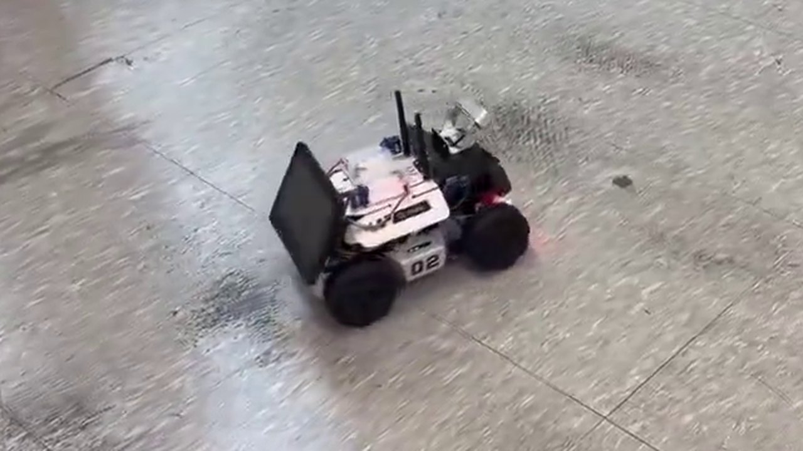</td>
<td align="center" width="25%">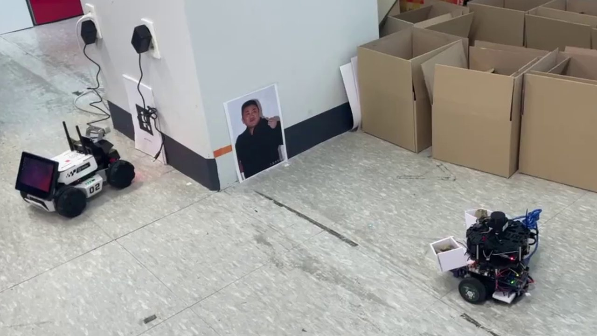</td>
<td align="center" width="25%">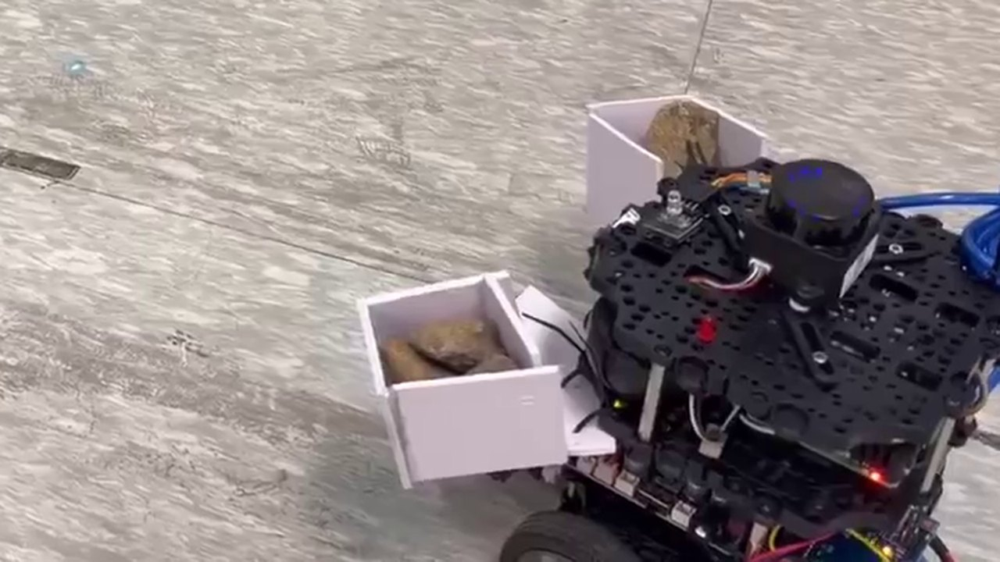</td>
<td align="center" width="25%">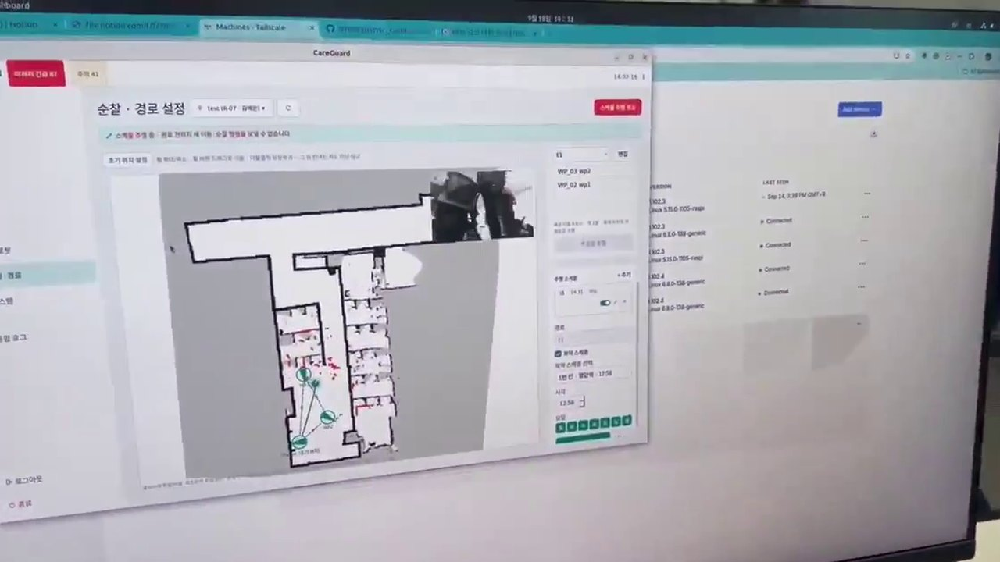</td>
</tr></tbody>
<tbody><tr>
<td align="center">LIMO 주행</td>
<td align="center">두 로봇 동시 순찰</td>
<td align="center">약통 슬롯</td>
<td align="center">P6 실시간 순찰 화면</td>
</tr></tbody>
</table>

</details>

## 7. 약통 구조

<p align="center">
  
</p>

- **열기** : `medication_task`가 서비스를 호출하면 `pillbox_controller`가 `OPEN A`를 보낸다.
- **수령 확인** : IR 센서가 약을 꺼낸 것을 감지하면 5초 뒤 닫히고 `CLOSED A`를 알린다.
- **실패 처리** : 20초 안에 꺼내지 않으면 강제로 닫고 `jammed`로 기록한다.

## 8. 시퀀스 다이어그램

운영 시나리오에서 서버 · 로봇 · 화면 사이에 오가는 명령 · 응답과 작업 순서를 나타낸 다이어그램입니다.

<details>
<summary><strong>Scenario 1. 정기 순찰과 재실 확인</strong></summary>

<p align="center">
  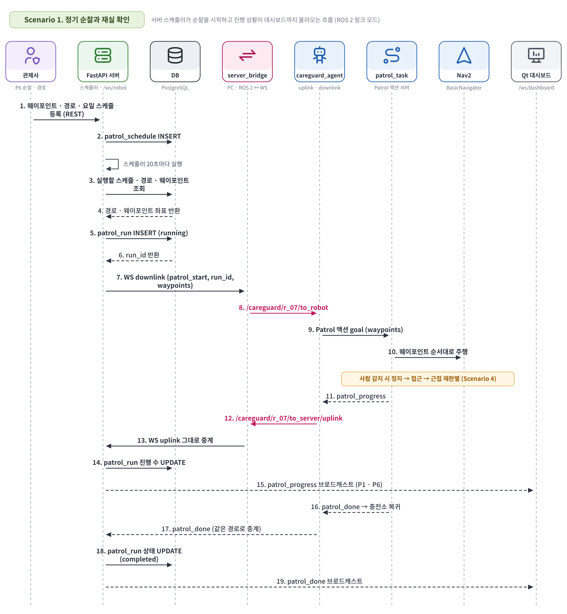
</p>

</details>

<details>
<summary><strong>Scenario 2. 복약 시간 관리</strong></summary>

<p align="center">
  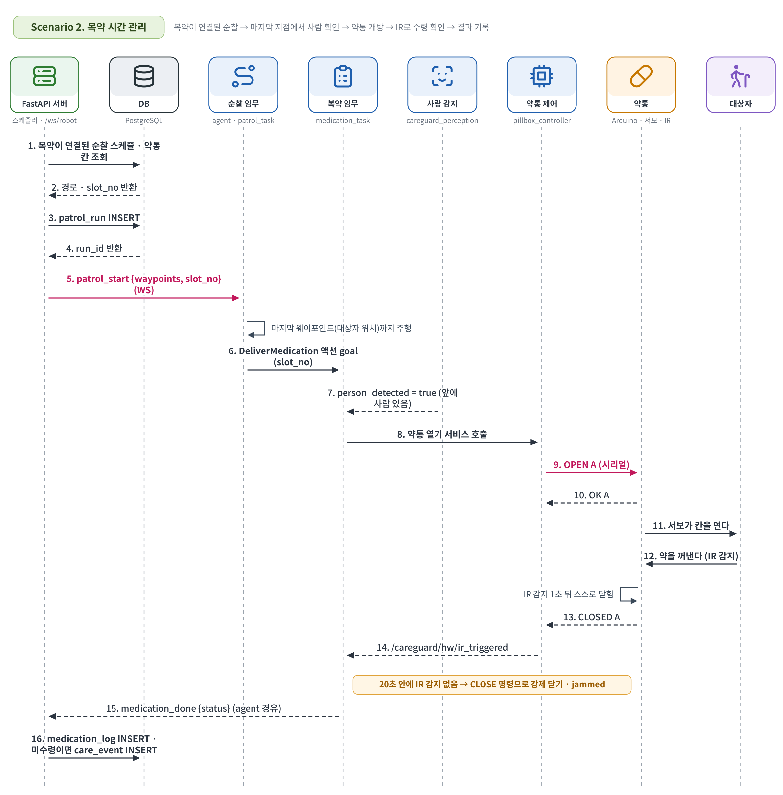
</p>

</details>

<details>
<summary><strong>Scenario 3. 응급 상황(SOS) 대응</strong></summary>

<p align="center">
  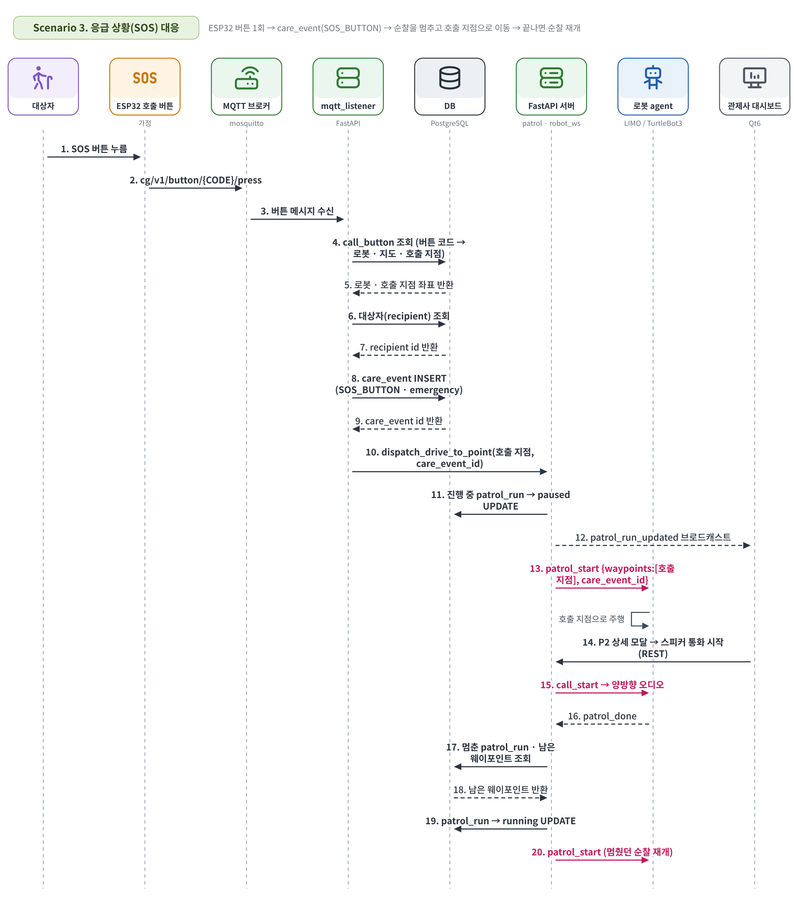
</p>

</details>

<details>
<summary><strong>Scenario 4. 미등록 인물 감지</strong></summary>

<p align="center">
  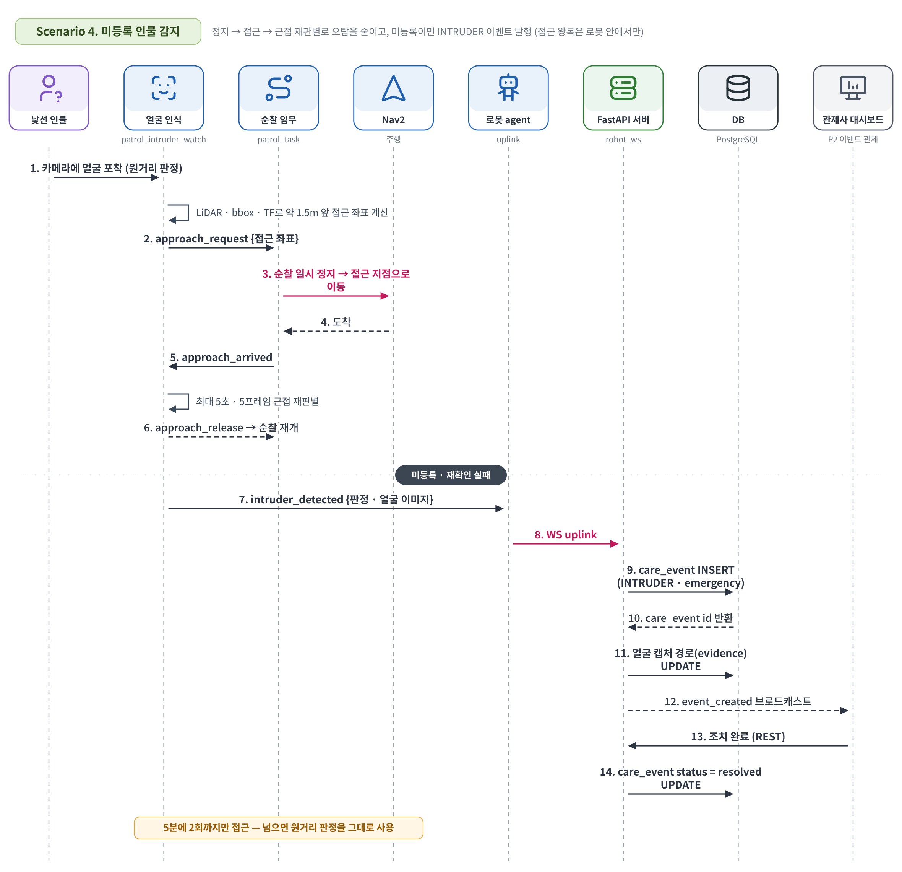
</p>

</details>

<details>
<summary><strong>ROS 2 링크 연결과 해제</strong></summary>

<p align="center">
  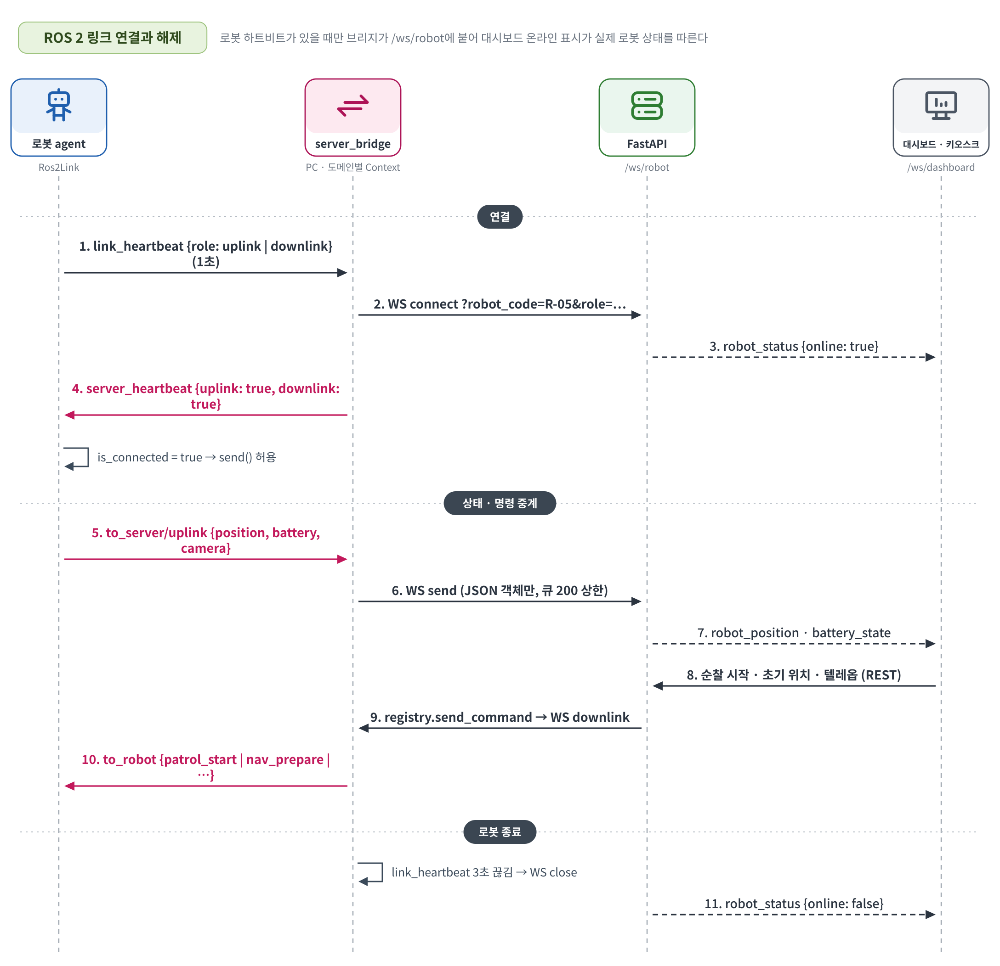
</p>

</details>

## 9. 핵심 기술과 문제 해결

<table>
<thead>
<tr><th align="left">과제 · 문제</th><th align="left">적용 기술 · 해결</th><th align="left">의미</th></tr>
</thead>
<tbody><tr><td align="left">서로 다른 공유기의 로봇 연결</td><td align="left">Wi-Fi LAN + Tailscale VPN, 로봇별 <code>ROS_DOMAIN_ID</code></td><td align="left">서버 1대로 여러 가정의 로봇 관제</td></tr></tbody>
<tbody><tr><td align="left">침입자 오탐</td><td align="left">정지 → 접근(~1.5m) → 근접 재판별, 5분 2회 rate limit</td><td align="left">원거리 판정만으로 경보하지 않음</td></tr></tbody>
<tbody><tr><td align="left">약통 동작이 계속 <code>hw_error</code> · <code>jammed</code>로 실패</td><td align="left">약통 시리얼 포트 설정과 응답 읽기 방식 수정 (<a href="docs/TroubleShooting/2026-09-17-pillbox-hw-error-serial-port-and-ack-buffering.md">기록</a>)</td><td align="left">IR 디버그 트래픽에 응답이 밀리던 문제 해소</td></tr></tbody>
<tbody><tr><td align="left">TurtleBot 카메라가 화면에 안 뜸</td><td align="left">카메라 중계 추가, 상하반전을 소프트웨어로 보정 (<a href="docs/TroubleShooting/2026-09-11-turtlebot-camera-relay.md">기록</a>)</td><td align="left">VPN 너머 로봇의 영상 관제</td></tr></tbody>
<tbody><tr><td align="left">ArUco 도킹 추가 후 CPU 과부하</td><td align="left">카메라 처리를 도킹할 때만 켜도록 변경 (<a href="docs/TroubleShooting/2026-09-15-turtlebot-aruco-cpu-overload.md">기록</a>)</td><td align="left">Raspberry Pi 자원 확보</td></tr></tbody>
<tbody><tr><td align="left">SOS 1회에 이벤트 2건</td><td align="left">남아 있던 서버 프로세스 정리 (<a href="docs/TroubleShooting/2026-09-14-sos-button-duplicate-care-event.md">기록</a>)</td><td align="left">이벤트 중복 방지</td></tr></tbody>
<tbody><tr><td align="left">대시보드가 소켓 7개 사용</td><td align="left">페이지별 연결을 하나로 공유 (<a href="docs/TroubleShooting/2026-09-14-dashboard-ws-duplicate-connections.md">기록</a>)</td><td align="left">서버 연결 수 감소</td></tr></tbody>
<tbody><tr><td align="left">R-06 배터리 · 위치 값 유실</td><td align="left">OpenCR 포트를 고정 경로로 지정 (<a href="docs/TroubleShooting/2026-09-17-r06-online-status-and-opencr-usb-conflict.md">기록</a>)</td><td align="left">USB 장치 충돌 해소</td></tr></tbody>
</table>

관련 기록: [TroubleShooting/](docs/TroubleShooting) (문제 · 원인 · 해결 기록 31건)

## 10. 중앙 서버와 ROS 2 통신

로봇과 서버 사이 실시간 연결을 기존 WebSocket 외에 ROS 2 토픽으로도 쓸 수 있게 했습니다.

- **로봇 쪽** : `CAREGUARD_LINK=ros2`로 켜면 서버에 WebSocket을 열지 않고 토픽만 쓴다.
- **서버 쪽** : `careguard_server_bridge`가 로봇별 도메인에 참여해 기존 `/ws/robot`으로 그대로 넘긴다.
- **온라인 판정** : 로봇 신호가 3초 끊기면 연결을 닫아 대시보드에 오프라인으로 표시된다.
- **영향 범위** : 서버 코드는 바꾸지 않았고, 설정하지 않으면 로봇은 예전처럼 동작한다.

<table>
<thead>
<tr><th align="left">토픽</th><th align="left">방향</th><th align="left">내용</th></tr>
</thead>
<tbody><tr><td align="left"><code>/careguard/&lt;robot&gt;/to_server/*</code></td><td align="left">로봇 → 서버</td><td align="left">위치 · 배터리 · 카메라 · 순찰 진행</td></tr></tbody>
<tbody><tr><td align="left"><code>/careguard/&lt;robot&gt;/to_robot</code></td><td align="left">서버 → 로봇</td><td align="left">순찰 시작 · 초기 위치 · 원격 명령</td></tr></tbody>
<tbody><tr><td align="left"><code>/careguard/&lt;robot&gt;/link_heartbeat</code></td><td align="left">로봇 → 브리지</td><td align="left">1초마다 생존 신호</td></tr></tbody>
</table>

<p align="center">
  
</p>

> 실제 FastAPI 서버에 붙여 위치 중계 · 온라인 표시 · 명령 전달을 확인했습니다. 실제 로봇에서의 장시간 검증은 아직입니다. 토픽 전체는 [`shared/api_contract/ros2_link.md`](shared/api_contract/ros2_link.md)에 있습니다.

## 11. 관제 대시보드

> **로봇 · 대상자 상태, 이벤트, 영상, 순찰 일정을 하나의 대시보드에서 관리합니다.**

<table>
<thead>
<tr><th align="left">화면</th><th align="left">주요 기능</th></tr>
</thead>
<tbody><tr><td align="left"><strong>P1 · 통합 관제</strong></td><td align="left">로봇 · 대상자 상태, 알림 피드, 로봇별 비상정지</td></tr></tbody>
<tbody><tr><td align="left"><strong>P2 · 이벤트 관제</strong></td><td align="left">미처리 이벤트, 상세 모달에서 통화 · 119 · 조치</td></tr></tbody>
<tbody><tr><td align="left"><strong>P3 · 대상자 관리</strong></td><td align="left">위험도 순 카드, 복약 스케줄, 보호자 연락처</td></tr></tbody>
<tbody><tr><td align="left"><strong>P4 · 영상 관리</strong></td><td align="left">열람 사유 입력 후 재생, 열람 이력 기록</td></tr></tbody>
<tbody><tr><td align="left"><strong>P5 · 맵 · 로봇</strong></td><td align="left">SLAM 매핑, 방향키 원격 조종</td></tr></tbody>
<tbody><tr><td align="left"><strong>P6 · 순찰 · 경로</strong></td><td align="left">웨이포인트 · 경로 · 스케줄 편집</td></tr></tbody>
<tbody><tr><td align="left"><strong>P7 · 시스템 설정</strong></td><td align="left">로봇 등록, 계정, 임계값 · 알림</td></tr></tbody>
<tbody><tr><td align="left"><strong>P8 · 통합 로그</strong></td><td align="left">순찰 · 복약 · 감사 로그 조회</td></tr></tbody>
</table>

<table>
<tbody><tr>
<td align="center" width="50%"></td>
<td align="center" width="50%"></td>
</tr></tbody>
<tbody><tr><td align="center">P2 이벤트 관제</td><td align="center">P3 대상자 관리</td></tr></tbody>
<tbody><tr>
<td align="center"></td>
<td align="center"></td>
</tr></tbody>
<tbody><tr><td align="center">P4 영상 관리</td><td align="center">P5 맵 · 로봇</td></tr></tbody>
</table>

<details>
<summary><strong>설정 · 로그 화면 더 보기</strong></summary>

<table>
<tbody><tr>
<td align="center" width="33%"></td>
<td align="center" width="33%"></td>
<td align="center" width="33%">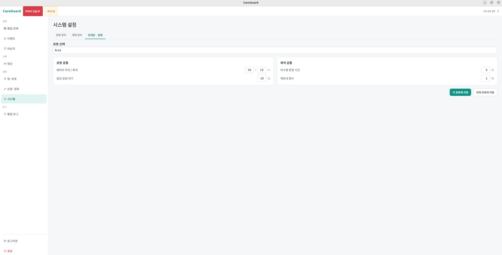</td>
</tr></tbody>
<tbody><tr><td align="center">P7 로봇 관리</td><td align="center">P7 계정 관리</td><td align="center">P7 임계값 · 알림</td></tr></tbody>
<tbody><tr>
<td align="center"></td>
<td align="center">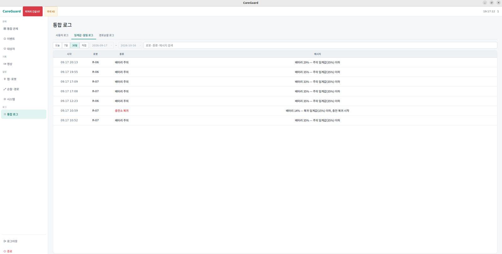</td>
<td align="center">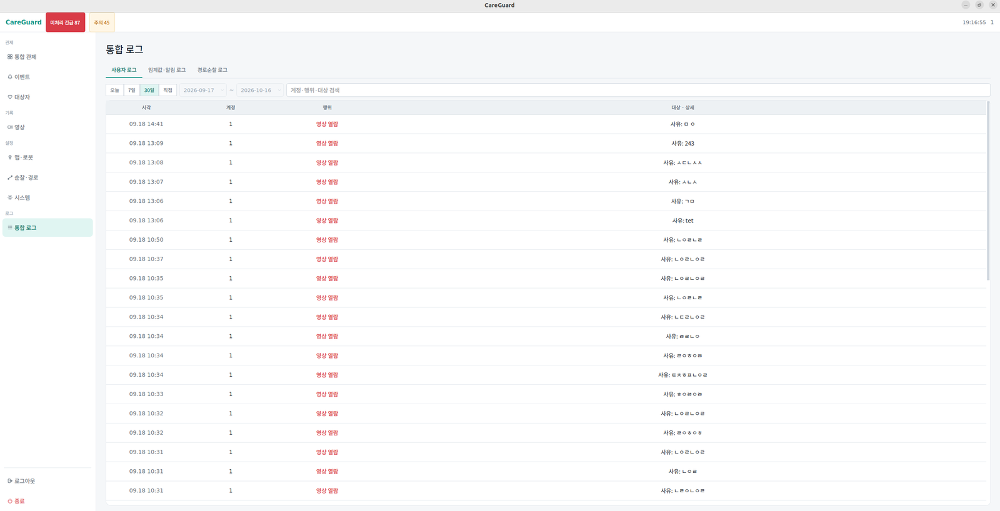</td>
</tr></tbody>
<tbody><tr><td align="center">P8 순찰 로그</td><td align="center">P8 알림 로그</td><td align="center">P8 사용자 로그</td></tr></tbody>
</table>

</details>

## 12. 현재 한계와 확장 목표

<table>
<thead>
<tr><th align="left">현재 한계</th><th align="left">다음 개선 목표</th></tr>
</thead>
<tbody><tr><td align="left">P6를 짧은 간격으로 다시 열면 순찰 프로세스가 겹쳐 재시작됨 (<a href="docs/TroubleShooting/2026-09-18-r07-nav-prepare-patrol-task-restart-race.md">진단 기록</a>)</td><td align="left">순찰 실행 프로세스 중복 방지 코드 반영</td></tr></tbody>
<tbody><tr><td align="left">원거리 판정 결과가 근접 재판별보다 먼저 나가는 침입자 오탐 레이스</td><td align="left">근접 재판별 완료 전 경보 보류</td></tr></tbody>
<tbody><tr><td align="left">119 모의 신고는 화면 표시용 시연 기능</td><td align="left">실제 신고 연동 검토</td></tr></tbody>
<tbody><tr><td align="left">ROS 2 링크는 실제 로봇 장시간 검증 전</td><td align="left">실제 로봇 장시간 운용 시험</td></tr></tbody>
<tbody><tr><td align="left">약통 수정(9/17) 이후 연속 배출 재검증 기록 없음</td><td align="left">연속 배출 반복 시험</td></tr></tbody>
</table>

## 13. 소스 구성

```text
.
├── pc_careguard/
│   ├── server/              # FastAPI 중앙 서버 — REST · WebSocket · 스케줄러 · MQTT · 이메일
│   ├── ros2_bridge/         # ROS 2 토픽 ↔ 서버 WebSocket 중계
│   ├── dashboard/           # Qt6 관제 대시보드 (P1~P8)
│   └── db/                  # PostgreSQL 스키마 · 마이그레이션
├── robot_careguard_ws/      # LIMO 워크스페이스 — agent · 순찰 · 복약 · 인식 · 약통
├── careguard_turtlebot_agent/  # TurtleBot3 agent
├── deploy/                  # Docker Compose · mosquitto · 후면 키오스크
├── shared/api_contract/     # 로봇 ↔ 서버 통신 계약
└── docs/                    # 시나리오 · 설계 · 트러블슈팅 · 이미지
```

<table>
<thead>
<tr><th align="left">경로</th><th align="left">역할</th></tr>
</thead>
<tbody><tr><td align="left"><a href="pc_careguard/server"><code>pc_careguard/server/</code></a></td><td align="left">FastAPI 중앙 서버 — REST · WebSocket · 스케줄러 · MQTT · 이메일</td></tr></tbody>
<tbody><tr><td align="left"><a href="pc_careguard/ros2_bridge"><code>pc_careguard/ros2_bridge/</code></a></td><td align="left">ROS 2 토픽 ↔ 서버 WebSocket 중계</td></tr></tbody>
<tbody><tr><td align="left"><a href="pc_careguard/dashboard"><code>pc_careguard/dashboard/</code></a></td><td align="left">Qt6 관제 대시보드 (P1~P8)</td></tr></tbody>
<tbody><tr><td align="left"><a href="pc_careguard/db"><code>pc_careguard/db/</code></a></td><td align="left">PostgreSQL 스키마 · 마이그레이션</td></tr></tbody>
<tbody><tr><td align="left"><a href="robot_careguard_ws"><code>robot_careguard_ws/</code></a></td><td align="left">LIMO 워크스페이스 — agent · 순찰 · 복약 · 인식 · 약통</td></tr></tbody>
<tbody><tr><td align="left"><a href="careguard_turtlebot_agent"><code>careguard_turtlebot_agent/</code></a></td><td align="left">TurtleBot3 agent</td></tr></tbody>
<tbody><tr><td align="left"><a href="deploy"><code>deploy/</code></a></td><td align="left">Docker Compose · mosquitto · 후면 키오스크</td></tr></tbody>
</table>

## 14. 프로젝트 기술 스택

### Robot & Middleware

<p>
  
  
  
  
</p>

### Hardware

<p>
  
  
  
  
  
  
</p>

### AI Vision & Voice

<p>
  
  
  
  
  
</p>

### Backend & Data

<p>
  
  
  
  
  
  
</p>

### GUI

<p>
  
  
</p>

### 운영 · 협업

<p>
  
  
  
  
  
</p>

## 15. 설치와 실행

### 15.1 저장소 준비

```bash
git clone https://github.com/postwo/DYNC_CareGuard-PROJECT2.git
cd DYNC_CareGuard-PROJECT2
```

### 15.2 실행 순서

<table>
<thead>
<tr><th align="left">순서</th><th align="left">실행 명령</th></tr>
</thead>
<tbody><tr><td align="left">1. DB · MQTT</td><td align="left"><code>cd deploy &amp;&amp; cp .env.example .env &amp;&amp; docker compose up -d</code></td></tr></tbody>
<tbody><tr><td align="left">2. 서버</td><td align="left"><code>cd pc_careguard/server &amp;&amp; pip install -r requirements.txt &amp;&amp; uvicorn app.main:app --host 0.0.0.0 --port 8000</code></td></tr></tbody>
<tbody><tr><td align="left">3. 대시보드</td><td align="left"><code>cd pc_careguard/dashboard &amp;&amp; cmake -B build &amp;&amp; cmake --build build &amp;&amp; ./build/careguard_dashboard</code></td></tr></tbody>
<tbody><tr><td align="left">4. 로봇</td><td align="left">각 로봇의 systemd 서비스로 자동 기동</td></tr></tbody>
<tbody><tr><td align="left">5. ROS 2 링크 (선택)</td><td align="left">로봇에 <code>CAREGUARD_LINK=ros2</code> 설정 후 <code>ros2 launch careguard_server_bridge bridge.launch.py</code></td></tr></tbody>
</table>

DB · SMTP 계정 등 비밀값은 `.env`에만 두고 Git에 올리지 않습니다. 자세한 절차는 [`docs/WORKSPACE_GUIDE.md`](docs/WORKSPACE_GUIDE.md)를 참고하세요.

## 16. 문서

<table>
<thead>
<tr><th align="left">문서</th><th align="left">내용</th></tr>
</thead>
<tbody><tr><td align="left"><a href="docs/CareGuard_SCENARIO.md">CareGuard_SCENARIO.md</a></td><td align="left">사용 시나리오 7종 · 알려진 한계</td></tr></tbody>
<tbody><tr><td align="left"><a href="docs/WORKSPACE_GUIDE.md">WORKSPACE_GUIDE.md</a></td><td align="left">저장소 구조 · 실행 방법 · DB 스키마</td></tr></tbody>
<tbody><tr><td align="left"><a href="docs/FOLDER_STRUCTURE.md">FOLDER_STRUCTURE.md</a></td><td align="left">패키지 · 파일 설계</td></tr></tbody>
<tbody><tr><td align="left"><a href="docs/design/CareGuard_DESIGN_SYSTEM.md">CareGuard_DESIGN_SYSTEM.md</a></td><td align="left">화면 상태 배지 · 퀵액션 기준</td></tr></tbody>
<tbody><tr><td align="left"><a href="shared/api_contract/ros2_link.md">ros2_link.md</a></td><td align="left">로봇 ↔ 서버 ROS 2 토픽 계약</td></tr></tbody>
<tbody><tr><td align="left"><a href="docs/TroubleShooting">TroubleShooting/</a></td><td align="left">문제 · 원인 · 해결 기록 31건</td></tr></tbody>
</table>
