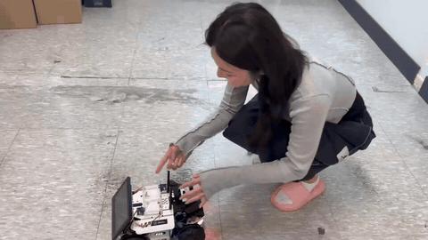
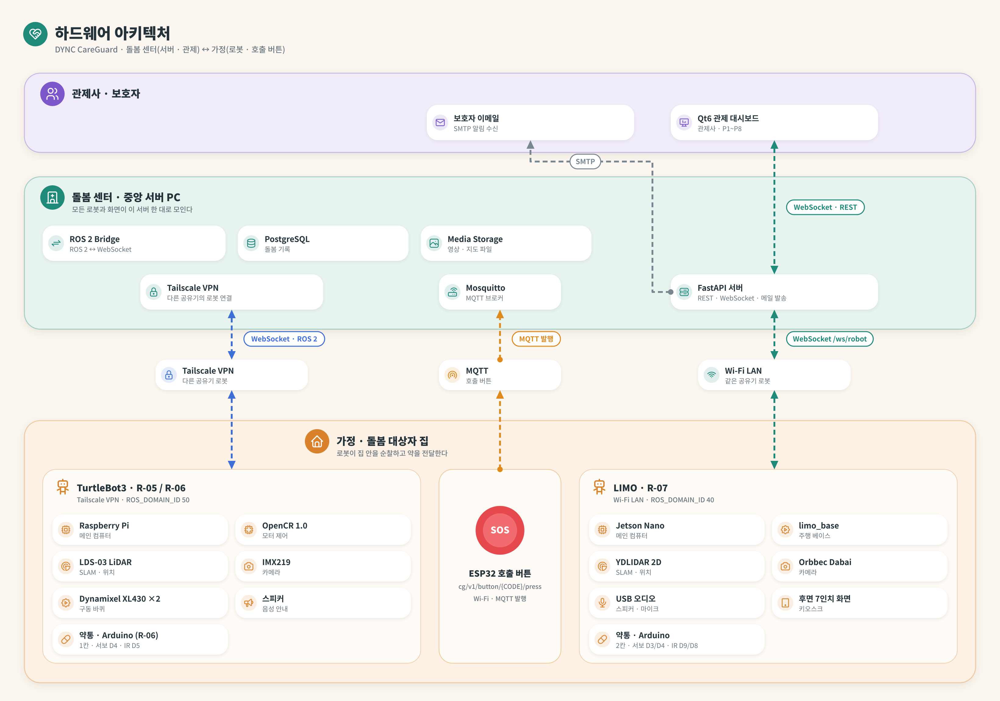
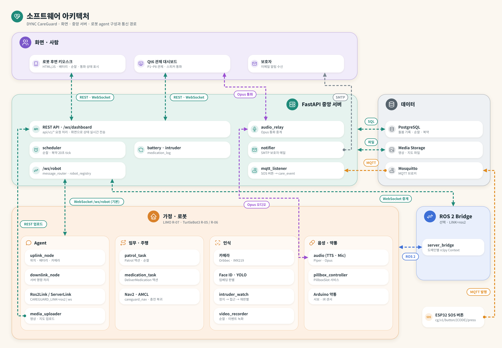
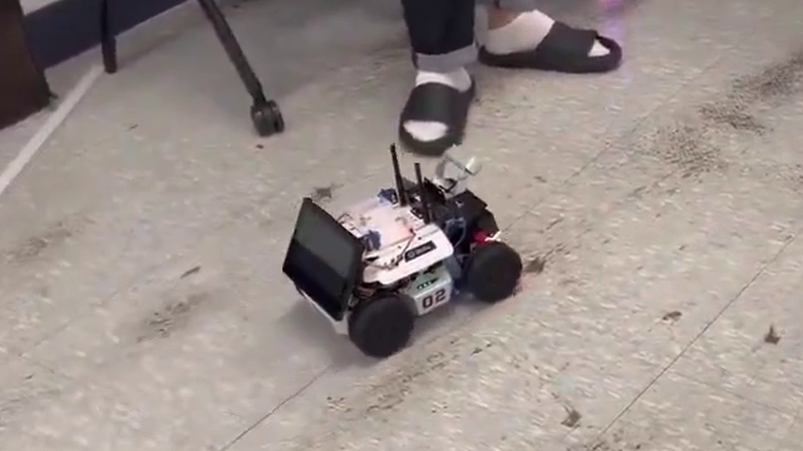
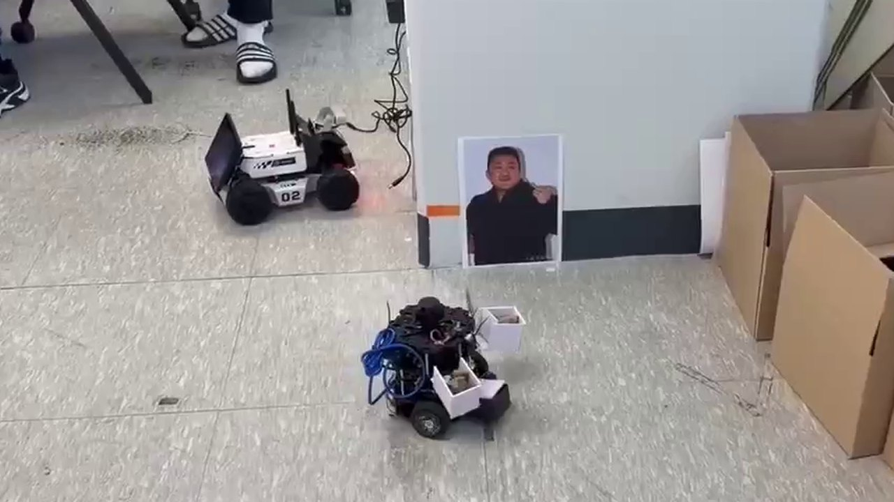
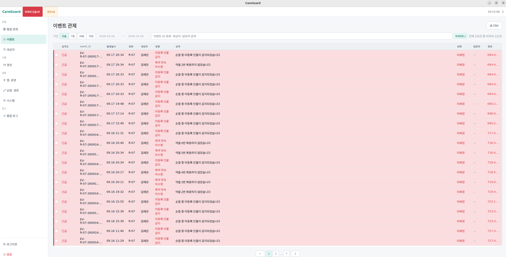
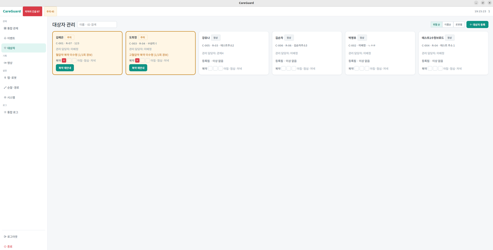

# DYNC CareGuard · 독거노인 순찰 · 복약 · 응급 대응 로봇

### 팀 DYNC · ROS 2 실내 자율주행 돌봄 로봇 프로젝트

> **로봇이 집 안을 돌며 대상자를 확인하고, 약을 건네고, 위급 상황을 바로 알립니다.**

LIMO · TurtleBot3 · ROS 2 Humble · Nav2 · YOLO 얼굴 인식 · FastAPI · Qt6 · PostgreSQL 로 만든 돌봄 로봇 서비스입니다.
실제 로봇 3대(R-05 · R-06 · R-07)에 배포해 검증했고, 발견한 문제는 [`docs/TroubleShooting/`](docs/TroubleShooting)에 31건 기록했습니다.

| LIMO (R-07) 순찰 | TurtleBot3 (R-05 / R-06) 순찰 |
| :-: | :-: |
|  |  |
| [▶ 시연 영상 1](https://youtu.be/W13FbSS3s6g) | [▶ 시연 영상 2](https://youtu.be/5YQFwCbIxe0) |

---

## 1. 팀 구성 및 역할

| 담당자 | 담당 파트 | 주요 기여 |
| :---: | :---: | --- |
| 최치언 | 로봇 연동 · 배터리 · 관제 화면 | 터틀봇·LIMO 서버 연동과 Tailscale 원격 연결, 부팅 시 자동 실행, 배터리 경보·자동 충전 복귀, 복약 미수령 감지, 로봇 상세·통합관제 화면 |
| 도희정 | 이벤트 · 대상자 · 순찰 파이프라인 | P2 이벤트·P3 대상자 관리, 순찰 일시정지·재개·SOS 끼어들기, 대상자/침입자 판별과 care_event 생성, 보호자 이메일 알림 |
| 강유나 | 얼굴 인식 · 매핑 · 키오스크 | 얼굴 데이터 수집·YOLO 학습·임베딩 정확도 개선, P5 매핑·P6 순찰 스케줄 화면, 로봇 후면 키오스크 |
| 김예은 | 복약 하드웨어 · 영상 · 음성 | 약통 펌웨어와 `pillbox_controller`, ESP32 응급 호출 버튼, 순찰 영상 녹화·음성 안내, 권한별 대시보드 화면 |

> 담당 내용은 `git log`의 작성자별 커밋과 트러블슈팅 문서 작성자를 기준으로 정리했습니다.

## 2. 프로젝트 주제

| 항목 | 내용 |
| :-- | :-- |
| 대상 | 상시 대면 케어가 어려운 독거노인 가정 |
| 로봇 | LIMO (R-07), TurtleBot3 Burger (R-05 · R-06) |
| 운용 | 중앙 서버 1대가 여러 로봇과 관제 화면·보호자 알림을 연결 |
| 네트워크 | 같은 공유기의 로봇은 Wi-Fi LAN, 다른 공유기의 로봇은 Tailscale VPN으로 서버에 연결 |
| 개발 기간 | 2026.09.06 ~ 09.18 |

## 3. 주제 선정 이유

독거노인 돌봄에 기술을 활용하는 시도는 이미 실제 현장에서 확산되고 있습니다. 국내 65세 이상 고령자 가구 565만 5천 가구 중 213만 8천 가구(37.8%)가 혼자 사는 독거노인 가구이고, AI 돌봄 인형 '효돌'은 약 180개 지자체를 통해 1만 3천여 명의 어르신에게 보급되어 복약 알림 등에 쓰이고 있습니다. 반면 집 안을 움직이지 못하는 기기는 안전 확인 · 약 전달 · 응급 대응까지 맡기 어렵다는 한계가 뚜렷합니다.

- **돌봄 인력 공백**: 상시 방문이 어려운 가정을 로봇이 정해진 시각에 순찰합니다.
- **복약 확인**: 약을 건네는 데서 그치지 않고 실제로 꺼내 갔는지 IR 센서로 확인합니다.
- **안전 확인**: 얼굴 인식으로 대상자 재실을 확인하고, 미등록 인물은 다가가 다시 판별해 오탐을 줄입니다.
- **응급 연결**: SOS가 들어오면 관제사가 로봇을 통해 바로 대응하고 보호자에게 알립니다.
- **다중 로봇 통합 운영**: 종류가 다른 로봇을 하나의 서버와 대시보드로 관리합니다.

**최종 목표** — 사람이 매번 방문하지 않아도 로봇이 순찰 · 복약 · 응급 대응을 수행하고, 관제사와 보호자가 같은 데이터로 대상자를 돌보는 서비스를 구현합니다.

출처: [통계청 「2024 고령자 통계」 보도](https://www.ytn.co.kr/_ln/0102_202409261817206289) · [효돌 보급 현황 보도 (2025)](https://v.daum.net/v/20251010140138228)

## 4. 핵심 기능

- **정기 순찰** : 요일·시각 스케줄로 순찰하고, 얼굴을 확인한 뒤 충전소로 돌아간다.
- **복약 관리** : 복약 시각에 이동해 안내하고, 약통을 열고, IR 센서로 수령을 확인한다.
- **응급 대응** : 화면 버튼·호출 버튼·음성으로 SOS를 받고 관제사와 통화를 연결한다.
- **침입자 감지** : 멈춰서 다가간 뒤 다시 판별해 오탐을 줄인다.
- **통합 관제** : Qt 대시보드(P1~P8)와 로봇 후면 키오스크로 상태를 보여 준다.
- **보호자 알림** : 이벤트가 생기면 이메일을 보내고, 보호자는 읽기 전용 화면을 쓴다.

## 5. 기능 요구사항

| ID | 기능 | 요구사항 |
| :-- | :-- | :-- |
| F-01 | 순찰 스케줄 | 예약 시각에 순찰을 시작하고, 로봇이 끊겨 있으면 다음 주기에 다시 시도한다. |
| F-02 | 웨이포인트 순회 | 등록된 경로를 순서대로 돌고 끝나면 충전소로 복귀한다. |
| F-03 | 재실 확인 | 순찰 중 얼굴을 검출해 등록된 대상자인지 판별한다. |
| F-04 | 침입자 감지 | 정지 → 접근 → 재판별 후 미등록이면 `INTRUDER` 이벤트를 만든다. |
| F-05 | 복약 전달 | 음성 안내 → 약통 개방 → IR 수령 확인 → 결과 기록 순으로 진행한다. |
| F-06 | 미수령 경보 | 미수령이 반복되면 이벤트로 올리고 보호자에게 메일을 보낸다. |
| F-07 | SOS 수신 | 화면 버튼·물리 버튼(MQTT)·음성으로 응급 이벤트를 만든다. |
| F-08 | 스피커 통화 | 관제사와 대상자가 로봇을 통해 양방향으로 통화한다. |
| F-09 | 배터리 보호 | 주의 임계값에서 경보하고, 복귀 임계값에서 충전소로 돌아간다. |
| F-10 | 실시간 관제 | 위치·배터리·카메라·라이다·순찰 진행을 실시간으로 보여 준다. |
| F-11 | SLAM · 원격 조종 | 대시보드에서 지도를 만들고 방향키로 로봇을 조종한다. |
| F-12 | 권한 분리 | 관제사와 보호자 계정을 나누고, 보호자는 자기 대상자만 본다. |
| F-13 | 감사 로그 | 영상 열람·비상정지·119·설정 변경 이력을 남긴다. |
| F-14 | 후면 키오스크 | 배터리·순찰·통화 상태를 로봇 뒷면 화면에 표시한다. |
| F-15 | ROS 2 링크 | 로봇과 서버의 실시간 연결을 ROS 2 토픽으로도 운용한다. |

## 6. 시스템 아키텍처

### 하드웨어 아키텍처

### 소프트웨어 아키텍처

## 7. 로봇 구성

| 구분 | LIMO (R-07) | TurtleBot3 (R-05 / R-06) |
| :-- | :-- | :-- |
| 메인 컴퓨터 | Jetson Nano | Raspberry Pi |
| LiDAR | YDLIDAR 2D | LDS-03 |
| 카메라 | Orbbec Dabai | IMX219 |
| 약통 | 2칸 (서보 D3·D4 / IR D9·D8) | 1칸, R-06 (서보 D4 / IR D5) |
| 음성 | 스피커 · 마이크 (TTS · 통화) | 스피커 (TTS) |
| 화면 | 후면 7인치 키오스크 | — |
| ROS_DOMAIN_ID | 40 | 50 |
| 서버 연결 | Wi-Fi LAN (서버와 같은 공유기) | Tailscale VPN (다른 공유기) |

<table>
  <tr>
    <td align="center" width="33%"></td>
    <td align="center" width="33%"></td>
    <td align="center" width="33%"></td>
  </tr>
  <tr>
    <td align="center">LIMO · 후면 키오스크</td>
    <td align="center">TurtleBot3 · 약통 탑재</td>
    <td align="center">순찰 중 재실 확인</td>
  </tr>
</table>

### 약통(디스펜서) 구조

- **열기** : `medication_task`가 서비스를 호출하면 `pillbox_controller`가 `OPEN A`를 보낸다.
- **수령 확인** : IR 센서가 약을 꺼낸 것을 감지하면 5초 뒤 닫히고 `CLOSED A`를 알린다.
- **실패 처리** : 20초 안에 꺼내지 않으면 강제로 닫고 `jammed`로 기록한다.

## 8. 운영 시나리오

### Scenario #1 - 정기 순찰과 재실 확인

1. 관제사가 P6에서 웨이포인트·경로·요일 스케줄을 등록한다.
2. 서버 스케줄러가 예약 시각에 순찰 명령을 보낸다.
3. 로봇이 경로를 돌다 사람을 보면 멈추고 다가가 얼굴을 다시 확인한다.
4. 순찰이 끝나면 충전소로 돌아가고 진행 상황이 대시보드에 반영된다.

### Scenario #2 - 복약 시간 관리

1. 복약 시각이 되면 로봇이 대상자에게 이동한다.
2. 얼굴로 대상자를 확인하고 "복약 시간입니다" 안내를 한다.
3. 약통이 열리고 IR 센서로 수령을 확인해 `delivered`로 기록한다.
4. 미수령이 반복되면 `MED_MISSED` 이벤트가 뜨고 보호자에게 메일이 간다.

### Scenario #3 - 응급 상황(SOS) 대응

1. 화면 버튼·호출 버튼·음성 중 하나로 SOS가 들어온다.
2. 진행 중이던 순찰을 멈추고 호출 지점으로 이동하며 녹화를 시작한다.
3. 관제사가 P2에서 스피커 통화를 시작하고 키오스크에 통화 상태가 뜬다.
4. 조치가 끝나면 이벤트를 완료하고, 멈췄던 순찰이 다시 이어진다.

### Scenario #4 - 미등록 인물 감지

1. 순찰 중 얼굴이 감지되면 로봇이 멈추고 약 1.5m까지 다가간다.
2. 가까이서 다시 판별해 등록된 대상자면 순찰을 계속한다.
3. 미등록이면 `INTRUDER` 이벤트와 얼굴 캡처를 관제 화면에 올린다.
4. 5분에 2회까지만 접근해 같은 사람을 계속 쫓지 않는다.

### Scenario #5 - 신규 로봇 등록

1. 관제사가 P7에서 로봇 코드와 `ROS_DOMAIN_ID`를 등록한다.
2. 로봇 agent가 서버에 연결되면 P1·P5에 온라인으로 표시된다.
3. P5에서 SLAM으로 지도를 만들고 P6에서 경로와 스케줄을 구성한다.

관제사 일상 운영 · 보호자 화면

- **관제사** : P1 통합 관제 → P2 이벤트 → P3 대상자 → P4 영상 → P5 매핑 → P6 순찰 → P7 설정 → P8 로그 순으로 확인한다.
- **보호자** : 연결된 대상자만 읽기 전용으로 보고, 이벤트가 생기면 이메일을 받는다.

전체 단계는 [`docs/CareGuard_SCENARIO.md`](docs/CareGuard_SCENARIO.md)를 참고하세요.

## 9. 시퀀스 다이어그램

각 시나리오에서 서버·로봇·화면 사이에 오가는 메시지 순서입니다.

### Scenario #1 - 정기 순찰

### Scenario #3 - 응급 상황(SOS) 대응

### ROS 2 링크 연결과 해제

## 10. 중앙 서버와 ROS 2 통신

로봇과 서버 사이 실시간 연결을 기존 WebSocket 외에 ROS 2 토픽으로도 쓸 수 있게 했습니다.

- **로봇 쪽** : `CAREGUARD_LINK=ros2`로 켜면 서버에 WebSocket을 열지 않고 토픽만 쓴다.
- **서버 쪽** : `careguard_server_bridge`가 로봇별 도메인에 참여해 기존 `/ws/robot`으로 그대로 넘긴다.
- **온라인 판정** : 로봇 신호가 3초 끊기면 연결을 닫아 대시보드에 오프라인으로 표시된다.
- **영향 범위** : 서버 코드는 바꾸지 않았고, 설정하지 않으면 로봇은 예전처럼 동작한다.

| 토픽 | 방향 | 내용 |
| :-- | :-- | :-- |
| `/careguard/<robot>/to_server/*` | 로봇 → 서버 | 위치 · 배터리 · 카메라 · 순찰 진행 |
| `/careguard/<robot>/to_robot` | 서버 → 로봇 | 순찰 시작 · 초기 위치 · 원격 명령 |
| `/careguard/<robot>/link_heartbeat` | 로봇 → 브리지 | 1초마다 생존 신호 |

> 실제 FastAPI 서버에 붙여 위치 중계·온라인 표시·명령 전달을 확인했습니다. 실제 로봇에서의 장시간 검증은 아직입니다. 토픽 전체는 [`shared/api_contract/ros2_link.md`](shared/api_contract/ros2_link.md)에 있습니다.

## 11. 관제 대시보드

| 화면 | 주요 기능 |
| :-- | :-- |
| P1 통합 관제 | 로봇·대상자 상태, 알림 피드, 로봇별 비상정지 |
| P2 이벤트 관제 | 미처리 이벤트, 상세 모달에서 통화·119·조치 |
| P3 대상자 관리 | 위험도 순 카드, 복약 스케줄, 보호자 연락처 |
| P4 영상 관리 | 열람 사유 입력 후 재생, 열람 이력 기록 |
| P5 맵 · 로봇 | SLAM 매핑, 방향키 원격 조종 |
| P6 순찰 · 경로 | 웨이포인트·경로·스케줄 편집 |
| P7 시스템 설정 | 로봇 등록, 계정, 임계값·알림 |
| P8 통합 로그 | 순찰·복약·감사 로그 조회 |

<table>
  <tr>
    <td align="center" width="50%"></td>
    <td align="center" width="50%"></td>
  </tr>
  <tr>
    <td align="center">P2 이벤트 관제</td>
    <td align="center">P3 대상자 관리</td>
  </tr>
  <tr>
    <td align="center"></td>
    <td align="center"></td>
  </tr>
  <tr>
    <td align="center">P4 영상 관리</td>
    <td align="center">P5 맵 · 로봇</td>
  </tr>
</table>

## 12. 주요 문제 해결

| 문제 | 해결 |
| :-- | :-- |
| 복약 배출이 계속 `hw_error`·`jammed` | 약통 시리얼 포트 설정과 응답 읽기 방식 수정 ([기록](docs/TroubleShooting/2026-09-17-pillbox-hw-error-serial-port-and-ack-buffering.md)) |
| 터틀봇 카메라가 화면에 안 뜸 | 카메라 중계 추가, 상하반전을 소프트웨어로 보정 ([기록](docs/TroubleShooting/2026-09-11-turtlebot-camera-relay.md)) |
| ArUco 도킹 추가 후 CPU 과부하 | 카메라 처리를 도킹할 때만 켜도록 변경 ([기록](docs/TroubleShooting/2026-09-15-turtlebot-aruco-cpu-overload.md)) |
| SOS 1회에 이벤트 2건 | 남아 있던 서버 프로세스 정리 ([기록](docs/TroubleShooting/2026-09-14-sos-button-duplicate-care-event.md)) |
| 대시보드가 소켓 7개 사용 | 페이지별 연결을 하나로 공유 ([기록](docs/TroubleShooting/2026-09-14-dashboard-ws-duplicate-connections.md)) |
| R-06 배터리·위치 값 유실 | OpenCR 포트를 고정 경로로 지정 ([기록](docs/TroubleShooting/2026-09-17-r06-online-status-and-opencr-usb-conflict.md)) |

## 13. 현재 한계

- **순찰 재시작 레이스** : P6를 짧은 간격으로 다시 열면 순찰 프로세스가 겹쳐 재시작된다.
- **침입자 오탐 정정** : 멀리서 판정한 결과가 가까이서 다시 판별하기 전에 먼저 나갈 때가 있다.
- **119 모의 신고** : 실제 신고가 아니라 화면 표시용 시연 기능이다.
- **ROS 2 링크** : 실제 로봇에서 오래 돌려 본 검증은 아직이다.

## 14. 소스 구성

| 경로 | 역할 |
| :-- | :-- |
| [`pc_careguard/server/`](pc_careguard/server) | FastAPI 중앙 서버 — REST · WebSocket · 스케줄러 · MQTT · 이메일 |
| [`pc_careguard/ros2_bridge/`](pc_careguard/ros2_bridge) | ROS 2 토픽 ↔ 서버 WebSocket 중계 |
| [`pc_careguard/dashboard/`](pc_careguard/dashboard) | Qt6 관제 대시보드 (P1~P8) |
| [`pc_careguard/db/`](pc_careguard/db) | PostgreSQL 스키마 · 마이그레이션 |
| [`robot_careguard_ws/`](robot_careguard_ws) | LIMO 워크스페이스 — agent · 순찰 · 복약 · 인식 · 약통 |
| [`careguard_turtlebot_agent/`](careguard_turtlebot_agent) | TurtleBot3 agent |
| [`deploy/`](deploy) | Docker Compose · mosquitto · 후면 키오스크 |
| [`docs/`](docs) | 시나리오 · 설계 · 트러블슈팅 · 이미지 |

## 15. 프로젝트 기술 스택

| 구분 | 사용 기술 |
| :-- | :-- |
| Robot / Hardware | LIMO, TurtleBot3, Jetson Nano, Raspberry Pi, Arduino, ESP32 |
| Robot Middleware | ROS 2 Humble, Nav2, Cartographer, CycloneDDS |
| AI Vision · Voice | OpenCV, YOLO 얼굴 검출, 얼굴 임베딩, Piper TTS, Opus |
| Backend | FastAPI, WebSocket, PostgreSQL 16, MQTT(mosquitto), SMTP |
| GUI | Qt6 (C++), HTML/JS 키오스크 |
| 운영 · 협업 | Docker Compose, systemd, Tailscale, GitHub Actions, pytest |

## 16. 설치와 실행

| 순서 | 실행 명령 |
| :-- | :-- |
| 1. DB · MQTT | `cd deploy && cp .env.example .env && docker compose up -d` |
| 2. 서버 | `cd pc_careguard/server && pip install -r requirements.txt && uvicorn app.main:app --host 0.0.0.0 --port 8000` |
| 3. 대시보드 | `cd pc_careguard/dashboard && cmake -B build && cmake --build build && ./build/careguard_dashboard` |
| 4. 로봇 | 각 로봇의 systemd 서비스로 자동 기동 |
| 5. ROS 2 링크 (선택) | 로봇에 `CAREGUARD_LINK=ros2` 설정 후 `ros2 launch careguard_server_bridge bridge.launch.py` |

자세한 절차는 [`docs/WORKSPACE_GUIDE.md`](docs/WORKSPACE_GUIDE.md)를 참고하세요.

## 17. 문서

| 문서 | 내용 |
| :-- | :-- |
| [CareGuard_SCENARIO.md](docs/CareGuard_SCENARIO.md) | 사용 시나리오 7종 · 알려진 한계 |
| [WORKSPACE_GUIDE.md](docs/WORKSPACE_GUIDE.md) | 저장소 구조 · 실행 방법 · DB 스키마 |
| [FOLDER_STRUCTURE.md](docs/FOLDER_STRUCTURE.md) | 패키지 · 파일 설계 |
| [CareGuard_DESIGN_SYSTEM.md](docs/design/CareGuard_DESIGN_SYSTEM.md) | 화면 상태 배지 · 퀵액션 기준 |
| [ros2_link.md](shared/api_contract/ros2_link.md) | 로봇 ↔ 서버 ROS 2 토픽 계약 |
| [TroubleShooting/](docs/TroubleShooting) | 문제 · 원인 · 해결 기록 31건 |

---

**팀 DYNC**
