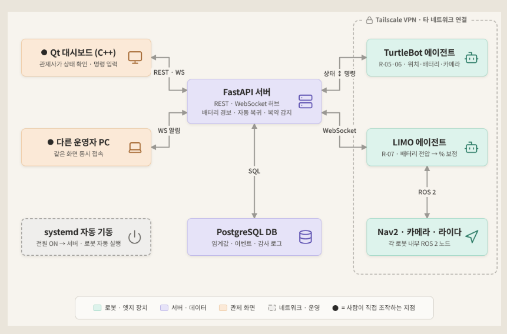
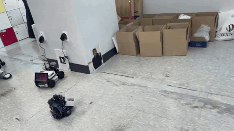
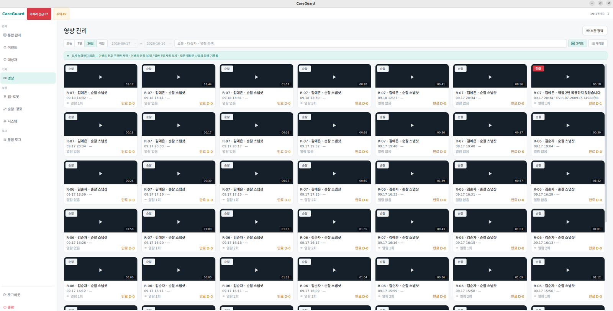
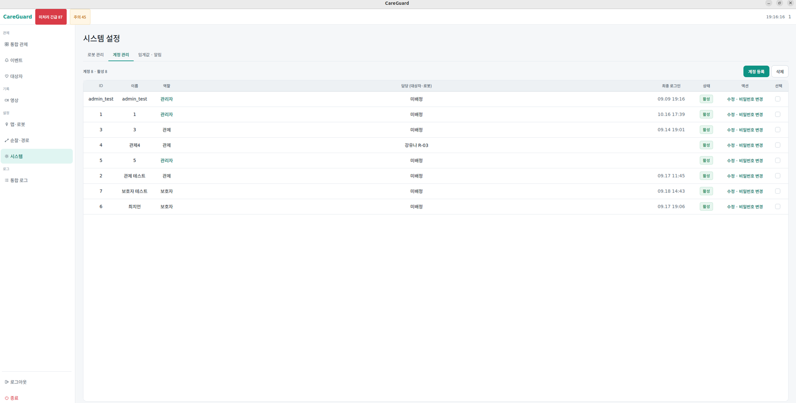
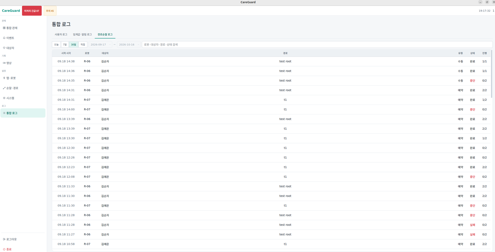

<div align="center">

# 🤖 DYNC CareGuard

**독거노인 돌봄 공백을 로봇과 원격 관제로 메우는 순찰 · 복약 · 응급 대응 서비스**


</div>

## 📖 프로젝트 소개

실내 자율주행 로봇(LIMO / TurtleBot3)이 독거노인 가정을 정기 순찰하며 **복약을 관리**하고, 낙상·SOS·미등록 침입자 같은 **이상 상황을 감지**해 원격 관제 대시보드와 보호자에게 즉시 알립니다.

- **문제의식**: 상시 대면 케어가 어려운 독거노인 가정의 복약 관리·안전 확인·응급 대응 공백
- **구성**: 순찰·복약 로봇 ↔ FastAPI 중앙 서버(WebSocket, PostgreSQL) ↔ Qt 관제 대시보드 + 로봇 후면 키오스크 + 보호자 이메일 알림
- **개발 방식**: 실제 로봇(LIMO, TurtleBot3)에 배포해 실기 검증하며 개발하고, 발견된 문제와 원인·해결 과정은 [`docs/TroubleShooting/`](docs/TroubleShooting)에 모두 기록

## ✨ 핵심 기능

| 기능 | 내용 |
| :-- | :-- |
| 🚶 정기 순찰 | 요일·시각 스케줄 또는 수동 트리거로 웨이포인트 순회, 안면인식으로 재실 확인 후 자동 충전 복귀 |
| 💊 복약 관리 | 복약 시각에 대상자에게 이동 → 음성 안내 → 약통 슬롯 개방(Arduino 서보) → IR 센서로 수령 확인 → 기록 |
| 🚨 응급 대응(SOS) | 화면 버튼 · 후면 물리 버튼 · 음성 3가지 경로, 관제사 스피커 통화(Opus) 및 119 모의 신고, 로봇별 E-STOP |
| 🕵️ 침입자 감지 | 정지 → 접근 → 근접 재판별 절차로 오탐을 줄이고 `INTRUDER` 이벤트 발행 |
| 🖥 통합 관제 대시보드 | Qt6 C++ 앱(P1~P8): 이벤트 큐, 대상자·보호자, 영상, SLAM 매핑, 경로·스케줄, 설정, 감사 로그 |
| 👪 보호자 알림/열람 | 이벤트 발생 시 SMTP 이메일, 보호자 계정은 본인 대상자로 제한된 읽기 전용 화면 |

## 🏗 시스템 아키텍처

<div align="center">
  
</div>

- 로봇은 서버와의 **유일한 통신구인 `careguard_agent`**(uplink/downlink 노드)로만 외부와 통신합니다. 다른 ROS 2 노드는 서버를 직접 알지 못합니다.
- ESP32 등 저사양 응급 호출 버튼은 MQTT(mosquitto)로 별도 연결됩니다.
- 로봇 쪽 워크스페이스는 PC에서 `rsync`로 배포하며, 로봇은 git 클라이언트 없이 수신 대상 역할만 합니다.

## 🎬 시나리오

자세한 단계별 흐름은 [`docs/CareGuard_SCENARIO.md`](docs/CareGuard_SCENARIO.md)에 있습니다.

| # | 시나리오 | 요약 |
| :-: | :-- | :-- |
| 1 | 정기 순찰과 재실 확인 | 서버 스케줄러가 20초 틱으로 순찰을 시작, 사람을 감지하면 정지·접근·재판별 후 등록자 확인 |
| 2 | 복약 시간 관리 | 대상자 확인 후 음성 안내와 슬롯 개방, IR 센서로 수령 확인, 미수령 반복 시 이벤트 승격 |
| 3 | 미등록 인물 감지 | 재확인 실패/미등록 판정 시 `INTRUDER`(emergency) 발행, 5분/2회 접근 제한으로 과도한 추적 방지 |
| 4 | 응급 상황(SOS) 대응 | 3가지 경로 → 대시보드 즉시 알림 |
| 5 | 관제사의 일상 운영 | P1~P8 대시보드 워크스루 |
| 6 | 보호자 뷰 | 연결된 대상자로 범위가 제한된 읽기 전용 모드 + 이메일 알림 |
| 7 | 신규 로봇 온보딩 | 로봇 등록 → WebSocket 연결 → SLAM 매핑 → 웨이포인트·경로·스케줄 구성 |

## 🚗 로봇 주행

실내 공간에서 실제 로봇이 주행하는 모습입니다. GIF는 주행 구간을 발췌한 미리보기이며, 전체 시연 영상은 링크에서 받아 볼 수 있습니다.

| LIMO (R-07) | TurtleBot3 (R-05/R-06) |
| :-: | :-: |
|  |  |
| [▶ 시연 영상 1 (전체)](docs/videos/careguard_demo_1.mp4) | [▶ 시연 영상 2 (전체)](docs/videos/careguard_demo_2.mp4) |

## 🖥 관제 대시보드

> Qt6 C++ 데스크톱 앱. 위험도·상태 우선순위(`EMERGENCY > ATTENTION > OFFLINE > NORMAL`)에 따라 조치가 급한 항목이 위로 올라옵니다.

### P2 이벤트 관제


미처리 필터가 기본이며 발생일시 기준으로 실시간 정렬됩니다. 상세 모달에서 진행 상황·조치·메모를 남기고 완료 처리합니다.

### P3 대상자 관리


위험도 순 카드 그리드(오늘 발생 이벤트 기준)에서 기본 정보 · 웨어러블 임계값 · 복약 스케줄 · 보호자 연락처를 관리합니다.

### P4 영상 관리 · P5 맵/로봇 매핑
| P4 영상 관리 | P5 맵 · 로봇 |
| :-: | :-: |
|  |  |
| 재생 전 열람 사유 입력, 열람 이력은 즉시 감사 로그에 기록 | SLAM 매핑과 방향키 텔레옵, 웨이포인트 등록 |

### P7 시스템 설정
| 로봇 관리 | 계정 관리 | 임계값 · 알림 |
| :-: | :-: | :-: |
|  |  |  |

### P8 통합 로그
| 사용자 로그 | 임계값 · 알림 로그 | 경로 · 순찰 로그 |
| :-: | :-: | :-: |
|  |  |  |

## 🛠 기술 스택

| 영역 | 스택 |
| :-- | :-- |
| 로봇 소프트웨어 | ROS 2 (Python), Nav2, Cartographer(SLAM), OpenCV/YOLO 안면인식, pyserial(Arduino 약통·서보) |
| 서버 | FastAPI, PostgreSQL, WebSocket, SMTP(보호자 이메일), MQTT(mosquitto) |
| 대시보드 | Qt6 C++ (Widgets / SvgWidgets / Multimedia / Network / WebSockets), Opus(음성 통화) |
| 로봇 후면 키오스크 | 정적 HTML/JS (빌드 없이 브라우저 실행) |
| 로봇 하드웨어 | LIMO(R-07), TurtleBot3(R-05/R-06), Arduino, ESP32 |
| 인프라 | Docker Compose(postgres, mosquitto), rsync 로봇 배포, systemd, Tailscale VPN |

## 📚 문서

| 문서 | 설명 |
| :-- | :-- |
| [CareGuard_SCENARIO.md](docs/CareGuard_SCENARIO.md) | 전체 사용 시나리오 7종 + 알려진 한계 |
| [WORKSPACE_GUIDE.md](docs/WORKSPACE_GUIDE.md) | 리포지토리 구조 · 개발 환경 실행 · DB 스키마 (기존 README) |
| [FOLDER_STRUCTURE.md](docs/FOLDER_STRUCTURE.md) | 패키지/파일 상세 설계 |
| [CareGuard_DESIGN_SYSTEM.md](docs/design/CareGuard_DESIGN_SYSTEM.md) | 상태 배지 우선순위, 퀵액션 등 UI 판단 기준 |
| [TroubleShooting/](docs/TroubleShooting) | 실기 개발 중 발견된 문제 · 원인 · 해결 기록 |
| [COMMIT_RULES.md](COMMIT_RULES.md) | 브랜치 전략 · 커밋 메시지 · PR 규칙 |
| [CONVENTIONS.md](CONVENTIONS.md) | 네이밍 · 리포 구조 · 파일 관리 규칙 |

## 🚀 빠른 시작

```bash
# 1) PostgreSQL + MQTT 브로커
cd deploy && cp .env.example .env && docker compose up -d

# 2) FastAPI 서버
cd pc_careguard/server && pip install -r requirements.txt && uvicorn app.main:app --reload

# 3) Qt 대시보드 (Qt6 + libopus-dev 필요)
cd pc_careguard/dashboard && cmake -B build && cmake --build build && ./build/careguard_dashboard
```

로봇 배포(`deploy/sync_to_limo.sh`), 키오스크 실행, DB 스키마 규칙은 [WORKSPACE_GUIDE](docs/WORKSPACE_GUIDE.md)를 참고하세요.

## ⚠️ 알려진 한계

- P6 페이지를 짧은 간격으로 재진입하면 순찰 실행 프로세스가 재시작되는 레이스가 진단되었고, 코드 수정은 반영 전입니다.
- 침입자 오탐(회피 판정 후 뒤늦은 정정) 레이스는 별도 조치 전 상태입니다.
- 119 모의 신고는 실제 신고가 아닌 시연용 표시 기능입니다.
