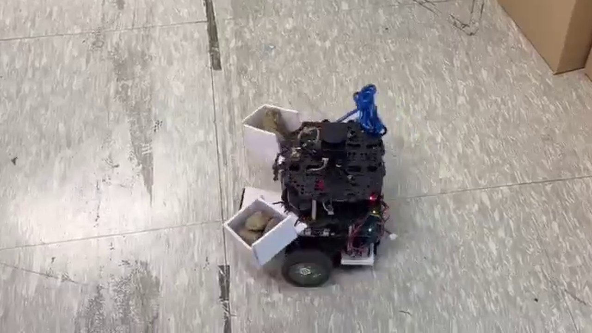
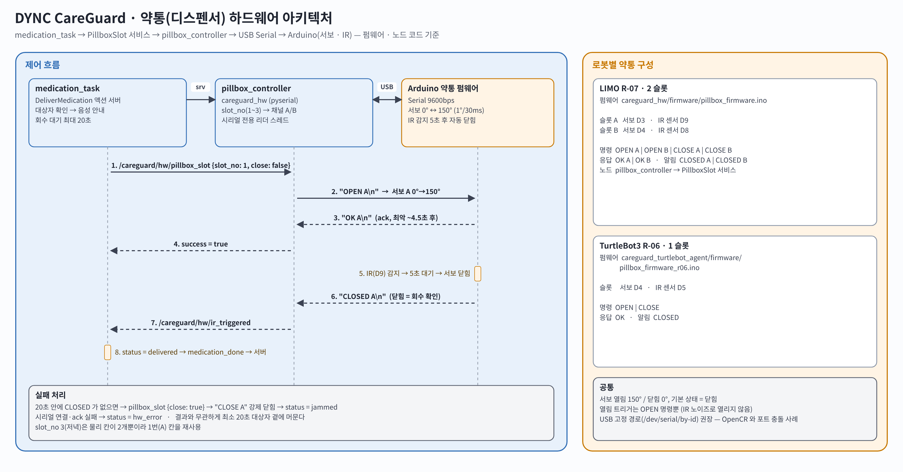
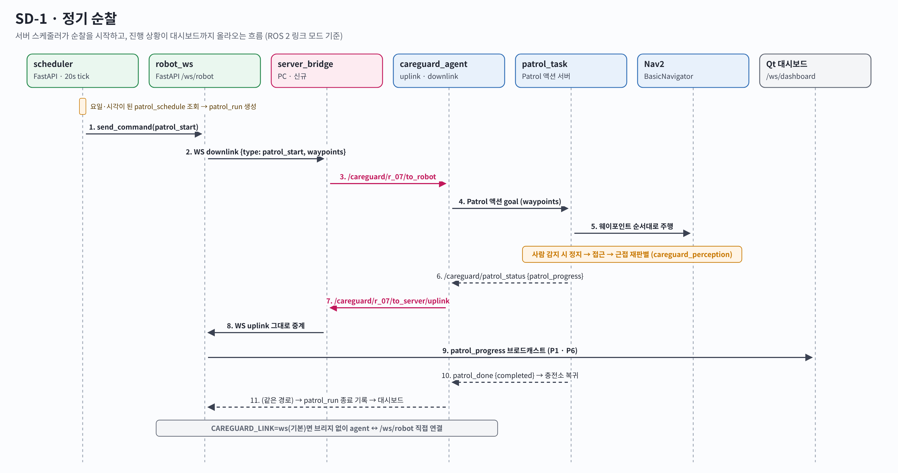
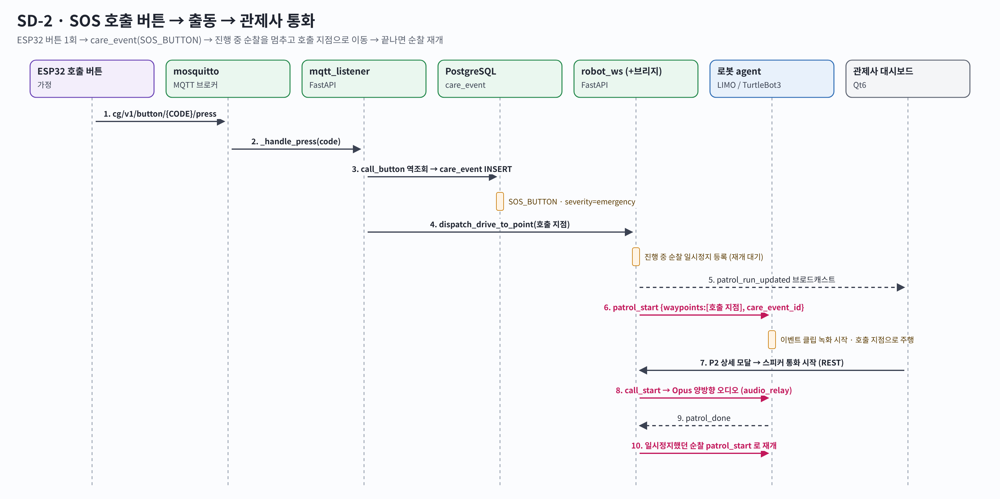
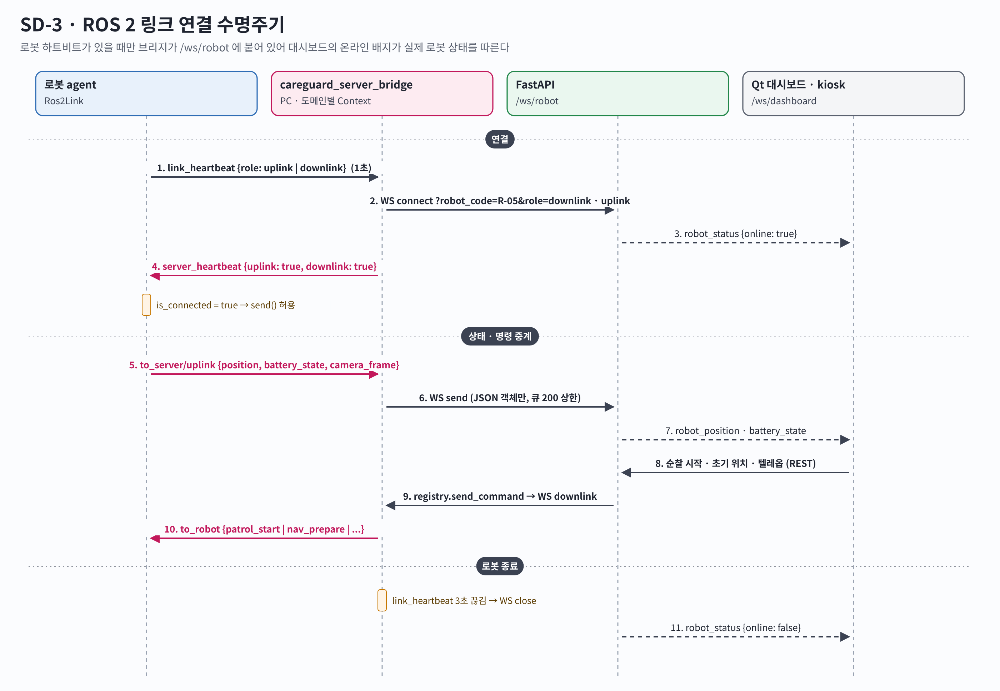
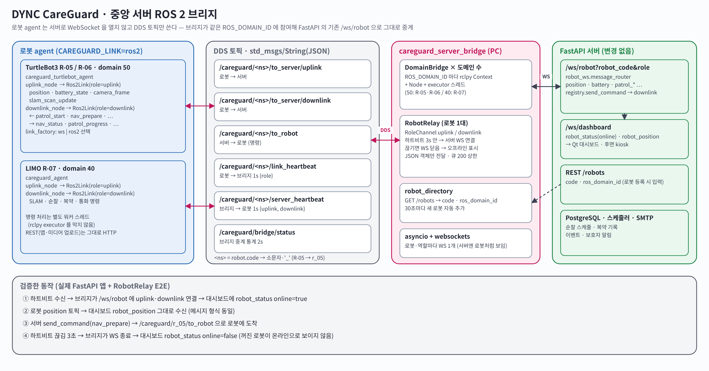
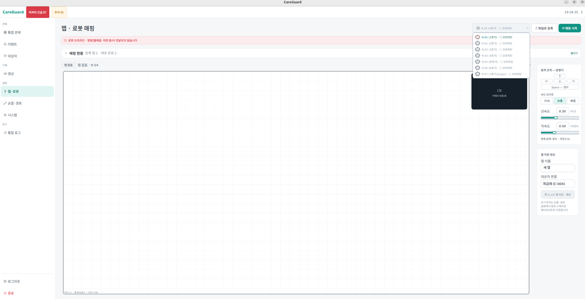
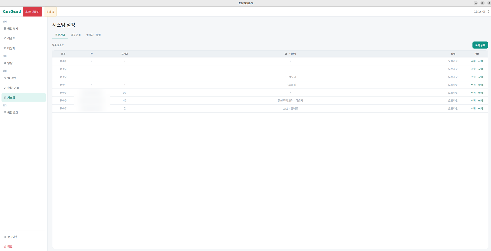

<div align="center">

# DYNC CareGuard · 독거노인 순찰 · 복약 · 응급 대응 로봇

### 팀 DYNC · ROS 2 실내 자율주행 돌봄 로봇 프로젝트

**프로젝트 기간: 2026.09.06 ~ 2026.09.18**

</div>

> 독거노인 돌봄 공백을 로봇과 원격 관제로 메우는 순찰 · 복약 · 응급 대응 서비스

실내 자율주행 로봇(LIMO / TurtleBot3)이 독거노인 가정을 정기 순찰하며 **복약을 관리**하고, 낙상·SOS·미등록 침입자 같은 **이상 상황을 감지**해 원격 관제 대시보드와 보호자에게 즉시 알립니다. 실제 로봇 3대(LIMO R-07, TurtleBot3 R-05/R-06)에 배포해 실기 검증하며 개발했고, 발견된 문제와 원인·해결 과정은 [`docs/TroubleShooting/`](docs/TroubleShooting)에 31건 기록했습니다.

### 시연 영상

| LIMO (R-07) 순찰 | TurtleBot3 (R-05/R-06) 순찰 |
| :-: | :-: |
|  |  |
| [▶ 시연 영상 1 (전체)](https://youtu.be/W13FbSS3s6g) | [▶ 시연 영상 2 (전체)](https://youtu.be/5YQFwCbIxe0) |

---

<details>
<summary><b>프로젝트 목차</b></summary>

1. [프로젝트 개요](#1-프로젝트-개요)
2. [팀 구성 및 역할](#2-팀-구성-및-역할)
3. [운영 시나리오](#3-운영-시나리오)
4. [기능 요구사항](#4-기능-요구사항)
5. [시스템 아키텍처](#5-시스템-아키텍처)
6. [하드웨어 구성](#6-하드웨어-구성)
7. [시퀀스 다이어그램](#7-시퀀스-다이어그램)
8. [중앙 서버와 ROS 2 통신](#8-중앙-서버와-ros-2-통신)
9. [통합 관제 대시보드](#9-통합-관제-대시보드)
10. [핵심 기술과 문제 해결](#10-핵심-기술과-문제-해결)
11. [구현 결과와 검증](#11-구현-결과와-검증)
12. [현재 한계와 확장 목표](#12-현재-한계와-확장-목표)
13. [소스 구성](#13-소스-구성)
14. [프로젝트 기술 스택](#14-프로젝트-기술-스택)
15. [설치와 실행](#15-설치와-실행)
16. [문서](#16-문서)

</details>

---

## 1. 프로젝트 개요

### 기획 배경 · 주제 선정 이유

상시 대면 케어가 어려운 독거노인 가정에서는 **복약 관리 · 안전 확인 · 응급 대응** 세 가지가 동시에 비어 있습니다. 사람이 매번 방문하지 않아도 로봇이 집 안을 돌며 대상자를 확인하고, 약을 건네고, 위급 상황을 관제사·보호자에게 바로 연결하는 것을 목표로 했습니다.

### 문제 정의

- **안전 확인**: 대상자가 집 안에 있는지, 낯선 사람이 들어왔는지를 사람 없이 정기적으로 확인해야 한다.
- **복약 관리**: 정해진 시각에 약을 전달하고 *실제로 꺼내 갔는지*까지 확인해야 한다.
- **응급 대응**: 도움 요청이 오면 관제사가 즉시 인지하고, 로봇을 통해 음성으로 대상자와 연결돼야 한다.
- **다중 로봇 운영**: 서로 다른 로봇(LIMO · TurtleBot3)을 하나의 서버·대시보드로 운영해야 한다.

### 개발 목표

- **정기 순찰**: 요일·시각 스케줄로 웨이포인트를 순회하고 안면인식으로 재실 확인, 끝나면 충전소로 자동 복귀
- **복약 관리**: 이동 → 음성 안내 → 약통 슬롯 개방(Arduino 서보) → IR 센서 수령 확인 → `medication_log` 기록
- **응급 대응**: 화면 버튼 · 물리 버튼 · 음성 3경로 SOS → 대시보드 즉시 알림 → 스피커 통화(Opus) · 119 모의 신고
- **침입자 감지**: 정지 → 접근 → 근접 재판별로 오탐을 줄이고 `INTRUDER` 이벤트 발행
- **통합 관제**: Qt6 대시보드(P1~P8)와 로봇 후면 키오스크, 보호자 이메일 알림
- **중앙 서버 ROS 2 통신(추가)**: 로봇 agent ↔ 중앙 서버 실시간 채널을 WebSocket 대신 ROS 2(DDS)로도 운용

---

## 2. 팀 구성 및 역할

| 담당자 | 담당 파트 (트러블슈팅 기록 기준) |
| :---: | :-- |
| **도희정** | 순찰 파이프라인(스케줄·취소·재시도·우선순위), 다운링크 맵/Nav2 수명주기, 복약 스케줄 동기화, SOS 버튼 중복 이벤트, 대시보드 WS 연결 정리, P3 대상자 관리 |
| **최치언** | TurtleBot3·LIMO 연결/카메라 릴레이, 배터리 보정·알림, R-06 Nav2 복구·ArUco 부하, 약통 시리얼(hw_error) 해결, OpenCR USB 충돌, 시스템 설정·계정 관리 |
| **강유나** | P5/P6 SLAM · Nav2 통합, 실로봇 순찰 디버깅 |
| **김예은** | P4 영상 녹화(video_recorder), 순찰 영상·음성 안내 |

> 커밋 계정: `postwo`, `dev-learning1`, `yuna`, `cuhote`. 각자의 상세 기록은 [`docs/TroubleShooting/`](docs/TroubleShooting)의 작성자 표기를 참고하세요.

---

## 3. 운영 시나리오

### Scenario 1 · 정기 순찰과 재실 확인

1. 관제사가 P6에서 맵 위에 웨이포인트(순찰 지점/충전 스테이션)를 찍고 순찰 경로와 요일·시각 스케줄을 등록한다.
2. 서버 스케줄러가 20초마다 틱을 돌며 예약 시각이 된 스케줄을 찾아 순찰을 시작한다. 로봇이 연결돼 있지 않으면 다음 틱에 재시도한다.
3. 로봇은 웨이포인트를 순회하다 사람을 감지하면 **정지 → 접근 → 근접 재판별**로 등록된 대상자인지 확인한다.
4. 순찰이 끝나면 충전 스테이션으로 자동 복귀하고, 진행 상황은 P1·P6에 실시간 반영된다.

### Scenario 2 · 복약 시간 관리

1. 복약 시각이 되면 서버가 로봇에 복약 임무를 내리고 로봇은 대상자 위치로 이동한다.
2. 안면인식으로 대상자를 확인하면 음성 안내 후 약통 슬롯을 연다(`OPEN A`/`OPEN B` 시리얼 명령).
3. IR 센서가 알약 반출을 감지하면 `delivered`, 회수가 없으면 `jammed`, 시리얼 실패면 `hw_error`로 기록한다.
4. 미수령이 반복되면 `MED_MISSED`/`MED_MISSED_STREAK` 이벤트로 승격돼 P2에 표시되고 보호자에게 이메일이 간다.

### Scenario 3 · 응급 상황(SOS) 대응

1. `SOS_SCREEN`(로봇 화면 버튼) · `SOS_BUTTON`(물리 버튼, ESP32 MQTT) · `SOS_VOICE`(음성 키워드) 중 하나로 이벤트가 발생한다.
2. `severity='emergency'`로 P2에 즉시 뜨고 경과 시간이 초 단위로 카운트업된다.
3. 관제사는 **스피커 통화**(Opus 양방향) 또는 **119 모의 신고**를 시작하고, 로봇 후면 키오스크에 상태가 표시된다.
4. 조치 후 이벤트를 완료 처리하면 P8 감사 로그에 남는다. P1에서 로봇별 **E-STOP**도 즉시 실행할 수 있다.

<details>
<summary><b>나머지 시나리오 (침입자 감지 · 관제사 운영 · 보호자 뷰 · 신규 로봇 온보딩)</b></summary>

| # | 시나리오 | 요약 |
| :-: | :-- | :-- |
| 4 | 미등록 인물 감지 | 라벨이 안정되면 진행 중 임무를 멈추고 ~1.5m까지 접근해 재판별, 실패·미등록이면 `INTRUDER`(emergency) 발행. 5분/2회 접근 제한 |
| 5 | 관제사의 일상 운영 | P1 통합 관제 → P2 이벤트 → P3 대상자 → P4 영상 → P5 매핑 → P6 순찰·경로 → P7 설정 → P8 로그 |
| 6 | 보호자 뷰 | 연결된 대상자로 범위가 제한된 읽기 전용 모드 + 이메일 알림 |
| 7 | 신규 로봇 온보딩 | 로봇 등록(코드·ROS_DOMAIN_ID) → agent 연결 → SLAM 매핑 → 웨이포인트·경로·스케줄 구성 |

전체 단계와 현재 상태: [`docs/CareGuard_SCENARIO.md`](docs/CareGuard_SCENARIO.md)

</details>

---

## 4. 기능 요구사항

> 별도 요구사항 명세서 대신, 시나리오 문서와 실제 구현 코드를 기준으로 기능을 정리했습니다.

<details>
<summary><b>기능 요구사항 펼쳐 보기</b></summary>

| ID | 기능 | 요구사항 | 구현 위치 |
| :-- | :-- | :-- | :-- |
| F-01 | 순찰 스케줄 | 요일·시각 스케줄에 맞춰 자동으로 순찰을 시작하고, 로봇 미연결 시 다음 틱에 재시도한다 | `server/app/services/scheduler.py` |
| F-02 | 웨이포인트 순회 | 등록된 경로를 순서대로 주행하고 종료 후 충전 스테이션으로 복귀한다 | `careguard_mission/patrol_task.py`, `careguard_turtlebot_agent/patrol_controller.py` |
| F-03 | 재실 확인 | 순찰 중 얼굴을 검출·임베딩 비교해 등록 대상자인지 판별한다 | `careguard_perception/` |
| F-04 | 침입자 감지 | 정지 → 접근 → 근접 재판별 후 미등록이면 `INTRUDER` 이벤트, 5분/2회 접근 제한 | `patrol_intruder_watch_node.py`, `services/intruder.py` |
| F-05 | 복약 전달 | 복약 시각에 이동 → 음성 안내 → 서보 슬롯 개방 → IR 수령 확인 → 기록 | `careguard_mission/medication_task.py`, `careguard_hw/pillbox_controller.py` |
| F-06 | 복약 미수령 승격 | 미수령·연속 미수령을 이벤트로 승격하고 보호자에게 이메일 발송 | `services/medication_log.py`, `services/notifier.py` |
| F-07 | SOS 3경로 | 화면 버튼·물리 버튼(MQTT)·음성으로 emergency 이벤트 생성 | `services/mqtt_listener.py`, `api/v1/event.py` |
| F-08 | 스피커 통화 | 관제사 ↔ 로봇 Opus 양방향 음성 통화 | `ws/audio_relay.py`, `careguard_hmi/` |
| F-09 | 배터리 보호 | 임계값 이하에서 주의 이벤트, 복귀 임계값에서 자동 충전 복귀 | `services/battery.py` |
| F-10 | 실시간 관제 | 위치·배터리·카메라·라이다 스캔·순찰 진행을 대시보드에 실시간 표시 | `ws/robot_ws.py`, `ws/dashboard_ws.py` |
| F-11 | SLAM · 텔레옵 | 대시보드에서 SLAM 매핑과 방향키 원격 조종, 웨이포인트 등록 | P5, `api/v1/teleop.py` |
| F-12 | 권한 분리 | 관제사/보호자 계정 분리, 보호자는 연결된 대상자 읽기 전용 | `core/accounts.py`, 대시보드 |
| F-13 | 감사 로그 | 영상 열람 사유·E-STOP·119·설정 변경 이력 기록 | `api/v1/audit.py`, P8 |
| F-14 | 후면 키오스크 | 배터리·순찰·통화/119 상태를 로봇 뒷면 화면에 표시, 재연결 시 상태 재조회 | `deploy/robot_kiosk/` |
| F-15 | ROS 2 링크 (추가) | 로봇 agent ↔ 중앙 서버 실시간 채널을 DDS 토픽으로도 운용, 서버 코드 변경 없이 중계 | `pc_careguard/ros2_bridge/`, `*/ros2_link.py` |

</details>

---

## 5. 시스템 아키텍처

<p align="center">
  
</p>

- 로봇은 서버와의 **유일한 통신구인 agent**(`careguard_agent` / `careguard_turtlebot_agent`의 uplink·downlink 노드)로만 외부와 통신합니다. 다른 ROS 2 노드는 서버를 직접 알지 못합니다.
- agent ↔ 서버 실시간 채널은 **WebSocket(기본)** 또는 **ROS 2 DDS(`CAREGUARD_LINK=ros2`)** 중 하나로 운용합니다. ROS 2 모드에서는 중앙 서버 PC의 `careguard_server_bridge`가 FastAPI의 기존 `/ws/robot`으로 그대로 중계합니다([8장](#8-중앙-서버와-ros-2-통신)).
- ESP32 응급 호출 버튼은 MQTT(mosquitto)로 서버에 별도 연결됩니다.
- 로봇 쪽 워크스페이스는 PC에서 `rsync`로 배포하며, 로봇은 systemd 서비스로 agent를 자동 기동합니다.

---

## 6. 하드웨어 구성

### 6.1 하드웨어 아키텍처

<p align="center">
  
</p>

| 구분 | LIMO (R-07) | TurtleBot3 Burger (R-05 / R-06) |
| :-- | :-- | :-- |
| 메인 컴퓨터 | Jetson Nano | Raspberry Pi |
| ROS_DOMAIN_ID | 40 | 50 |
| LiDAR | YDLIDAR 2D | LDS-03 (R-06) |
| 카메라 | Orbbec Dabai 깊이 카메라 | IMX219 CSI (`camera_ros`, R-05 상하반전 보정) |
| 구동 | limo_base (`/cmd_vel`, `LimoStatus` 배터리) | OpenCR 1.0 · Dynamixel XL430 ×2 (`/battery_state`) |
| 약통 | Arduino **2 슬롯** (서보 A D3 · B D4, IR A D9 · B D8) | Arduino **1 슬롯**, R-06 (서보 D4, IR D5) |
| 음성 | USB 오디오 스피커·마이크 (Piper TTS, Opus 통화) | 스피커 (Piper TTS) |
| 표시 | 후면 7인치 모니터 (robot_kiosk) | — |

| 장치 | 구성 |
| :-- | :-- |
| 응급 호출 버튼 | ESP32 + 버튼(GPIO INPUT_PULLUP), Wi-Fi → MQTT `cg/v1/button/{CODE}/press` |
| 약통 펌웨어 | 서보 0°↔150° 슬롯 개방, IR 감지 5초 후 자동 닫힘 → 시리얼 `OK`/`CLOSED` (`careguard_hw/firmware/`, `careguard_turtlebot_agent/firmware/`) |
| 중앙 서버 PC | FastAPI(uvicorn, systemd) · PostgreSQL 16 · mosquitto(Docker Compose) · ROS 2 브리지 · Qt6 대시보드 |
| 네트워크 | 같은 LAN 또는 Tailscale VPN |

### 6.2 실제 로봇 (시연 영상 캡처)

<table>
  <tr>
    <td width="33%" align="center"></td>
    <td width="33%" align="center"></td>
    <td width="33%" align="center"></td>
  </tr>
  <tr>
    <td align="center">LIMO (R-07) · 후면 7인치 키오스크 화면</td>
    <td align="center">TurtleBot3 · 측면 약통 탑재</td>
    <td align="center">약통 슬롯 근접 (시연용 모형 알약)</td>
  </tr>
  <tr>
    <td align="center"></td>
    <td align="center"></td>
    <td align="center"></td>
  </tr>
  <tr>
    <td align="center">등록 대상자 사진 앞 순찰 · 재실 확인</td>
    <td align="center">LIMO + TurtleBot3 동시 운용</td>
    <td align="center">관제 PC의 P6 순찰·경로 화면</td>
  </tr>
</table>

> 사진은 [`docs/videos/`](docs/videos) 시연 영상에서 캡처했습니다.

### 6.3 약통(디스펜서) 아키텍처

<p align="center">
  
</p>

- `medication_task`가 `/careguard/hw/pillbox_slot` 서비스로 슬롯을 열면, `pillbox_controller`가 USB 시리얼로 `OPEN A`를 보내고 `OK A` ack를 받습니다.
- 대상자가 약을 꺼내 IR 센서가 감지되면 펌웨어가 5초 뒤 스스로 닫고 `CLOSED A`를 알립니다. 이 알림이 곧 수령 확인(`delivered`)입니다.
- 20초 안에 회수가 없으면 강제로 닫고 `jammed`, 시리얼 실패는 `hw_error`로 기록합니다.

---

## 7. 시퀀스 다이어그램

<details open>
<summary><b>SD-1 · 정기 순찰</b></summary>

<p align="center"></p>

</details>

<details>
<summary><b>SD-2 · SOS 호출 버튼 → 출동 → 관제사 통화</b></summary>

<p align="center"></p>

</details>

<details>
<summary><b>SD-3 · ROS 2 링크 연결 수명주기</b></summary>

<p align="center"></p>

</details>

---

## 8. 중앙 서버와 ROS 2 통신

<p align="center">
  
</p>

기존 구조에서 로봇 agent는 각자 서버 주소로 WebSocket을 열어 상태를 올리고 명령을 받았습니다. 이번에 **로봇 ↔ 중앙 서버 실시간 채널을 ROS 2(DDS) 토픽으로도 운용**할 수 있게 했습니다.

- **로봇 쪽**: `ros2_link.Ros2Link`가 기존 `ServerLink`(WebSocket)와 같은 인터페이스(`start`/`send`/`is_connected`)를 제공합니다. `CAREGUARD_LINK=ros2`로 띄우면 uplink·downlink 노드가 서버로 WebSocket을 열지 않고 `/careguard/<robot>/…` 토픽만 씁니다. 기본값 `ws`면 동작은 기존과 같습니다.
- **서버 쪽**: 새 ROS 2 패키지 **`careguard_server_bridge`**([`pc_careguard/ros2_bridge`](pc_careguard/ros2_bridge))가 로봇의 `ROS_DOMAIN_ID`(R-05/R-06: 50, R-07: 40)마다 rclpy Context를 하나씩 만들어 동시에 참여하고, 토픽을 FastAPI의 기존 `/ws/robot?robot_code=..&role=..`로 그대로 중계합니다. **서버 코드와 메시지 형식은 바뀌지 않습니다.**
- **온라인 판정**: 브리지는 로봇의 `link_heartbeat`가 3초 안에 들어올 때만 서버 WS를 열어 둡니다. 로봇이 꺼지면 WS가 닫혀 대시보드 "온라인" 배지가 기존과 똑같이 꺼집니다.

| 토픽 (std_msgs/String JSON) | 방향 | 내용 |
| :-- | :-- | :-- |
| `/careguard/<ns>/to_server/uplink` | 로봇 → 서버 | `position` · `battery_state` · `camera_frame` · `slam_scan_update` … |
| `/careguard/<ns>/to_server/downlink` | 로봇 → 서버 | `nav_status` · `patrol_progress` · `patrol_done` · `medication_done` … |
| `/careguard/<ns>/to_robot` | 서버 → 로봇 | `patrol_start` · `patrol_stop` · `nav_prepare` · `set_initial_pose` … |
| `/careguard/<ns>/link_heartbeat` · `server_heartbeat` | 양방향 1초 | 역할별 생존·연결 상태 |
| `/careguard/bridge/status` | 브리지 | 도메인별 중계 통계 |

`<ns>`는 `robot.code`를 ROS 이름 규칙에 맞춘 값입니다(`R-05` → `r_05`). 전체 계약: [`shared/api_contract/ros2_link.md`](shared/api_contract/ros2_link.md)

```bash
# 서버 PC: FastAPI 가 떠 있는 상태에서
ros2 launch careguard_server_bridge bridge.launch.py server_url:=http://127.0.0.1:8000

# 로봇: systemd 서비스 Environment 에 한 줄 추가 (또는 셸에서)
CAREGUARD_LINK=ros2 CAREGUARD_ROBOT_CODE=R-05 ros2 run careguard_turtlebot_agent uplink_node
ros2 topic echo /careguard/bridge/status
```

> 검증 범위: 실제 FastAPI 앱(`/ws/robot`, `/ws/dashboard`)에 브리지 중계 계층을 붙여 위치 중계 · 온라인/오프라인 배지 · 서버 명령 전달을 E2E로 확인했고, 로봇 쪽 링크·브리지 단위 시험을 통과했습니다. 실제 로봇 DDS 환경에서의 장시간 주행 검증은 아직입니다. 맵·영상 업로드 같은 REST 호출은 그대로 HTTP를 씁니다.

---

## 9. 통합 관제 대시보드

> Qt6 C++ 데스크톱 앱. 위험도·상태 우선순위(`EMERGENCY > ATTENTION > OFFLINE > NORMAL`)에 따라 조치가 급한 항목이 위로 올라옵니다.

| 화면 | 주요 기능 |
| :-- | :-- |
| P1 통합 관제 | KPI 스트립, 로봇/대상자 상태 테이블, 알림 피드, 로봇별 E-STOP |
| P2 이벤트 관제 | 미처리 필터 기본, 실시간 정렬·페이징, 상세 모달에서 통화·119·조치·완료 |
| P3 대상자 관리 | 위험도 순 카드 그리드, 기본 정보·웨어러블 임계값·복약 스케줄·보호자 |
| P4 영상 관리 | 열람 사유 입력 후 재생, 열람 이력 감사 로그 기록 |
| P5 맵·로봇 매핑 | SLAM 매핑, 방향키 텔레옵, 웨이포인트 등록 |
| P6 순찰·경로 | 웨이포인트·경로·스케줄 편집, 라이다 스캔 오버레이 |
| P7 시스템 설정 | 로봇 등록, 관제사/보호자 계정, 임계값·알림 |
| P8 통합 로그 | 순찰·복약·감사 로그 날짜 범위 조회 |

<table>
  <tr>
    <td width="50%" align="center"></td>
    <td width="50%" align="center"></td>
  </tr>
  <tr><td align="center">P2 이벤트 관제</td><td align="center">P3 대상자 관리</td></tr>
  <tr>
    <td align="center"></td>
    <td align="center"></td>
  </tr>
  <tr><td align="center">P4 영상 관리</td><td align="center">P5 맵 · 로봇 매핑</td></tr>
</table>

<details>
<summary><b>P7 시스템 설정 · P8 통합 로그 화면</b></summary>

| 로봇 관리 | 계정 관리 | 임계값 · 알림 |
| :-: | :-: | :-: |
|  |  |  |

| 사용자 로그 | 임계값 · 알림 로그 | 경로 · 순찰 로그 |
| :-: | :-: | :-: |
|  |  |  |

</details>

---

## 10. 핵심 기술과 문제 해결

| 과제 | 적용 기술 · 접근 | 결과 |
| :-- | :-- | :-- |
| 오탐 없는 침입자 판정 | 라벨 안정화(DECIDING) → 라이다+bbox+TF 거리·방위 추정으로 접근 → 근접 재판별, 접근 횟수 제한 | R-07에서 정지→접근→재판별 E2E 성공 |
| 복약 배출 `hw_error`/`jammed` 반복 | 약통 시리얼 포트 오설정 수정, ack 읽기가 IR 디버그 트래픽에 밀리던 버퍼링 문제 해결 | [기록](docs/TroubleShooting/2026-09-17-pillbox-hw-error-serial-port-and-ack-buffering.md) |
| 터틀봇 카메라 미표시 | uplink 카메라 릴레이 추가, NV21→JPEG 인코딩 문제 회피, libcamera 0.1 상하반전을 소프트웨어 보정 | [기록](docs/TroubleShooting/2026-09-11-turtlebot-camera-relay.md) |
| ArUco 도킹 후 CPU 과부하 | 카메라 상시 구독·디코딩을 도킹 시점으로 한정, 충전소 외 정렬 제거 | [기록](docs/TroubleShooting/2026-09-15-turtlebot-aruco-cpu-overload.md) |
| SOS 1회에 이벤트 2건 | 공유 MQTT 브로커를 서버 인스턴스 2개가 동시 구독 → 남아 있던 서버 프로세스를 정리해 하나만 유지 | [기록](docs/TroubleShooting/2026-09-14-sos-button-duplicate-care-event.md) |
| 대시보드 소켓 7개 | 페이지마다 만들던 `WsClient`를 `MainWindow`에서 하나만 만들어 7개 페이지에 공유 주입 | [기록](docs/TroubleShooting/2026-09-14-dashboard-ws-duplicate-connections.md) |
| R-06 배터리·오도메트리 유실 | 다른 아두이노와 `/dev/ttyACM0`을 다투던 OpenCR를 `/dev/serial/by-id/…` 고정 경로로 지정 | [기록](docs/TroubleShooting/2026-09-17-r06-online-status-and-opencr-usb-conflict.md) |
| 로봇별 다른 DDS 도메인 | 서버 브리지가 도메인마다 rclpy Context를 따로 열어 동시에 참여 | `pc_careguard/ros2_bridge` |

전체 31건: [`docs/TroubleShooting/`](docs/TroubleShooting)

---

## 11. 구현 결과와 검증

| 구분 | 확인 내용 | 범위 |
| :-- | :-- | :-- |
| 순찰 | 스케줄 순찰·충전 복귀, 진행 상황 실시간 반영 | R-07 다회 실기 검증 |
| 침입자 감지 | 정지→접근→재판별 파이프라인 E2E 성공 | R-07, 2026-09-16 |
| 복약 | 시리얼 포트·ack 버퍼링 수정 완료 | 수정 후 연속 배출 재검증은 남음 |
| SOS · 통화 | 3경로 이벤트, Opus 통화, 키오스크 상태 표시 | 서버·대시보드·R-07 |
| 서버 | pytest (실제 PostgreSQL 스키마) + flake8, GitHub Actions | `.github/workflows/server-lint.yml` |
| ROS 2 링크 | 로봇 링크 17건 · 브리지 7건 단위 시험, 실제 FastAPI 앱 E2E(온라인/오프라인·위치·명령) | 실로봇 DDS 장시간 검증 전 |

```bash
cd careguard_turtlebot_agent && python3 -m pytest -q test
cd pc_careguard/ros2_bridge && python3 -m pytest -q test
```

---

## 12. 현재 한계와 확장 목표

| 현재 한계 | 확장 목표 |
| :-- | :-- |
| P6 재진입이 잦으면 순찰 프로세스가 재시작되며 DDS가 오염되는 레이스 ([진단](docs/TroubleShooting/2026-09-18-r07-nav-prepare-patrol-task-restart-race.md)) | 순찰 실행 프로세스 단일화 · 재시작 가드 |
| 원거리 판정과 근접 재확인이 경합해 침입자 오탐이 먼저 나가는 경우 | 근접 재확인 완료 전 알림 보류 |
| 119 모의 신고는 화면 표시용 | 실제 신고 연동 |
| ROS 2 링크는 실로봇 장시간 검증 전 | R-05/R-06/R-07 전환 후 연결 안정성 비교 |
| REST(맵·영상 업로드)는 여전히 HTTP | 필요 시 ROS 2 서비스로 이전 |

---

## 13. 소스 구성

```text
DYNC_CareGuard-PROJECT2/
├── pc_careguard/
│   ├── server/                # FastAPI 중앙 서버 (REST · /ws/robot · /ws/dashboard · 스케줄러 · MQTT · SMTP)
│   ├── ros2_bridge/           # ★ careguard_server_bridge: ROS 2 DDS ↔ /ws/robot 중계
│   ├── dashboard/             # Qt6 C++ 관제 대시보드 (P1~P8)
│   └── db/                    # PostgreSQL 스키마 · 마이그레이션
├── robot_careguard_ws/src/    # LIMO(R-07) 워크스페이스
│   ├── careguard_agent/       # uplink/downlink (+ ros2_link)
│   ├── careguard_mission/     # 순찰 · 복약 태스크
│   ├── careguard_nav/         # 웨이포인트 · 충전 복귀
│   ├── careguard_perception/  # 얼굴 검출 · 임베딩 · 녹화
│   ├── careguard_hmi/         # TTS · 통화 오디오
│   ├── careguard_hw/          # 약통 컨트롤러 · 펌웨어
│   └── careguard_bringup/ · careguard_msgs/
├── careguard_turtlebot_agent/ # TurtleBot3(R-05/R-06) agent (+ ros2_link, link_factory)
├── deploy/                    # docker-compose · mosquitto · robot_kiosk
├── shared/api_contract/       # API · ROS 2 링크 계약
└── docs/                      # 시나리오 · 설계 · 트러블슈팅 · 이미지
```

---

## 14. 프로젝트 기술 스택

### Robot & Middleware
<p>
  
  
  
  
  
  
  
</p>

### Vision & Voice
<p>
  
  
  
  
  
</p>

### Embedded
<p>
  
  
  
</p>

### Backend · GUI · Data
<p>
  
  
  
  
  
  
  
</p>

### Infra · 협업
<p>
  
  
  
  
  
  
</p>

---

## 15. 설치와 실행

### 15.1 저장소 받기

```bash
git clone https://github.com/postwo/DYNC_CareGuard-PROJECT2.git
cd DYNC_CareGuard-PROJECT2
```

### 15.2 장비별 준비

| 장비 | 작업 디렉터리 | 먼저 준비할 항목 |
| :-- | :-- | :-- |
| 중앙 서버 PC | `deploy/`, `pc_careguard/server/` | Docker, Python 3.10+, `.env`(DB·SMTP) |
| 중앙 서버 PC (ROS 2 브리지) | `pc_careguard/ros2_bridge/` | ROS 2 Humble, CycloneDDS, `python3-websockets` |
| 관제 PC | `pc_careguard/dashboard/` | Qt6, `libopus-dev` |
| LIMO (R-07) | `robot_careguard_ws/` | ROS 2 Humble, `CAREGUARD_SERVER_URL`, `CAREGUARD_ROBOT_CODE`, systemd 서비스 |
| TurtleBot3 (R-05/R-06) | `careguard_turtlebot_agent/` | ROS 2 Humble, Nav2, `camera_ros`, systemd 서비스 |

### 15.3 통합 실행 순서

1. PostgreSQL + MQTT 브로커

```bash
cd deploy && cp .env.example .env && docker compose up -d
```

2. FastAPI 서버

```bash
cd pc_careguard/server && pip install -r requirements.txt && uvicorn app.main:app --host 0.0.0.0 --port 8000
```

3. Qt 대시보드

```bash
cd pc_careguard/dashboard && cmake -B build && cmake --build build && ./build/careguard_dashboard
```

4. 로봇 agent — 기본(WebSocket)은 각 로봇의 systemd 서비스로 기동합니다. ROS 2 링크로 운용하려면 서비스 `Environment=`에 `CAREGUARD_LINK=ros2`를 추가하고 서버 PC에서 브리지를 띄웁니다.

```bash
mkdir -p ~/careguard_server_ws/src && ln -s "$PWD/pc_careguard/ros2_bridge" ~/careguard_server_ws/src/careguard_server_bridge
cd ~/careguard_server_ws && colcon build --symlink-install && source install/setup.bash
ros2 launch careguard_server_bridge bridge.launch.py server_url:=http://127.0.0.1:8000
```

상시 기동은 [`pc_careguard/ros2_bridge/systemd/careguard-server-bridge.service.in`](pc_careguard/ros2_bridge/systemd/careguard-server-bridge.service.in)을 참고하세요.

자세한 절차와 DB 스키마는 [`docs/WORKSPACE_GUIDE.md`](docs/WORKSPACE_GUIDE.md)를 참고하세요.

---

## 16. 문서

| 문서 | 설명 |
| :-- | :-- |
| [CareGuard_SCENARIO.md](docs/CareGuard_SCENARIO.md) | 전체 사용 시나리오 7종 + 알려진 한계 |
| [WORKSPACE_GUIDE.md](docs/WORKSPACE_GUIDE.md) | 리포지토리 구조 · 개발 환경 실행 · DB 스키마 |
| [FOLDER_STRUCTURE.md](docs/FOLDER_STRUCTURE.md) | 패키지/파일 상세 설계 |
| [CareGuard_DESIGN_SYSTEM.md](docs/design/CareGuard_DESIGN_SYSTEM.md) | 상태 배지 우선순위, 퀵액션 등 UI 판단 기준 |
| [ros2_link.md](shared/api_contract/ros2_link.md) | 로봇 agent ↔ 중앙 서버 ROS 2 토픽 계약 |
| [TroubleShooting/](docs/TroubleShooting) | 실기 개발 중 발견된 문제 · 원인 · 해결 기록 |
| [COMMIT_RULES.md](COMMIT_RULES.md) · [CONVENTIONS.md](CONVENTIONS.md) | 브랜치 · 커밋 · PR 규칙, 네이밍 · 구조 규칙 |

<br/>

<div align="center"><b>팀 DYNC</b></div>
